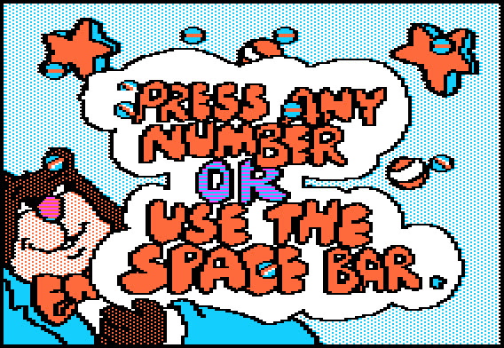
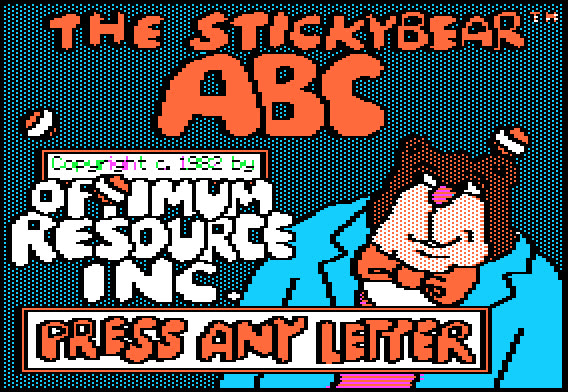
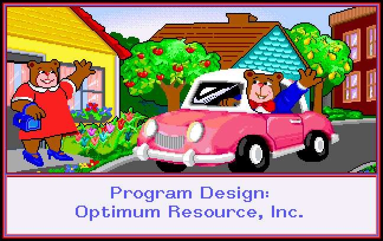

A dated attempt to identify one specific childhood memory of Trevor's — *a blue screen, a
bear, his dad's first office computer brought home for the weekend, floppy disks you had to
swap* — against the actual 1980s–90s software record. **The answer is a composite.** The
"doors, and you build machines out of what you learned, and race cars and planes" half is
[[gizmos-and-gadgets]] (The Learning Company, 1993, MS-DOS), and it is confirmed in detail. The
"bear" half is almost certainly [[stickybear]], but **which Stickybear cannot be resolved from
available sources** — no title in the line matches all of *blue screen + player-controlled bear
+ side-scrolling + office DOS machine* at once, and two of the four original diagnostic details
moved under questioning. Two products, ten years apart, fused into one memory is the ordinary
behaviour of nostalgia, not a failure of recall.

## In this game

This page exists because a wrong answer here becomes set dressing or a history card a child
reads. The project has caught four confident-but-wrong claims in the last day, and "force a
match to please the person who asked" is the exact failure mode the
`.claude/agents/arcade-historian.md` brief warns about. What it protects:

- **Any Act 2 / Act 3 background object** built from this memory. Trevor's own direction is
  **DRAW A REAL THING** (`docs/ROADMAP.md` §2). This page says which real thing: an Apple II
  with a 5.25-inch disk in the drive (Stickybear's actual home), or a beige DOS PC (Gizmos &
  Gadgets' actual home) — and **not** an invented Stickybear side-scroller, which never existed.
- **Any history card.** The card copy proposed in `research/educational-software.md` for
  `stickybear` describes [[stickybear-typing]] and is safe. A card describing a Stickybear
  *platformer* would be a fabrication.

Related: [[stickybear]] · [[stickybear-typing]] · [[stickybear-basketbounce]] ·
[[stickybear-town-builder]] · [[gizmos-and-gadgets]] · [[the-learning-company]] ·
[[floppy-disk]] · `research/educational-software.md`.

## The memory, as stated

First statement (2026-09-13), on being shown [[stickybear-typing]]:

> *"Stickybear typing — I don't recall if that was the stickybear I remember... Don't remember
> if it was math, reading, typing or something else. I primarily remember the genre — and the
> blue screen of my dad's first office computer he was allowed to bring home and the 3.5"
> actually floppy floppy disks to load it and it came with many you have to put in at various
> points in time on the game. Think it was a side scroller where you control the bear
> doing/exploring something."*

Second statement, same day, after the "3.5-inch vs *actually floppy*" contradiction was put
to him:

> *"True it was 5.25 floppy — yes! Maybe not multiple disks, but maybe. I do remember a blue
> screen with a bear — could be merging stickybear with gizmo and gadgets where you learn
> science through different doors and building different machines with the information you
> learned along the way — race cars, planes, helicopters, etc."*

**Two of the four original details moved within one exchange** (3.5" → 5.25"; multi-disk →
"maybe"). That is itself the strongest single piece of evidence for the composite reading, and
it is why no surviving detail should be treated as load-bearing on its own.

## What each detail is evidence for

| Detail | What it narrows to | Confidence |
|---|---|---|
| *"actually floppy"* → **5.25-inch** | Stickybear's 1982–87 window, and any DOS title before the early-90s 3.5-inch changeover. Rules out the 1988+ Apple 800K re-releases. | **High** — he corrected himself toward the physical sensation, which is the part memory keeps |
| *"dad's first office computer"* | An IBM PC or compatible, not an Apple II or C64 | Medium — the machine may be remembered correctly while the software on it is not |
| *"many disks you put in at various points"* | A multi-disk product | **Low** — retracted to "maybe" |
| *"side scroller where you control the bear"* | Discriminating, if reliable | Medium — but see below; no Stickybear title is a side-scroller |
| *"doors / build machines from what you learned / cars, planes"* | [[gizmos-and-gadgets]] | **High** — matches the documented design point for point |
| *"blue screen with a bear"* | **Stickybear's Apple II house palette** — see below. Rules the memory *toward* the Apple II era and *away* from the DOS Town Builder | **High** — verified by looking at the screens |

## Half one: Gizmos & Gadgets — confirmed

Every element of the second statement's description is documented:

- **Doors that open only when you've learned something.** *"Doors begin locked and can only be
  unlocked by solving a science-related puzzle."* Trevor's "learn science through different
  doors" is literally the navigation mechanic.
- **Build a machine out of what you won.** The player collects vehicle parts by solving physics
  puzzles in the Shady Glen warehouses, then assembles a vehicle and races it.
- **Cars and planes.** Three race categories, five races each: **automotive, alternative
  energy, and aircraft** — fifteen races against Morty Maxwell.
- **On a DOS office machine.** Released **1993 for MS-DOS and Macintosh**.

**Two honest qualifications.** (a) Trevor said "race cars, planes, **helicopters**" — the
documented third category is *alternative energy*, not helicopters. Whether a helicopter is
among the buildable aircraft is **unverified**; two of the three vehicle kinds he named map
cleanly onto documented categories and the third does not. (b) The disk format of the 1993
DOS release — 5.25-inch, 3.5-inch, or both, and how many disks — **could not be established**
this session; the Internet Archive's Super Solvers compilation is a single 1 GB RAR that hides
the original disk structure. So Gizmos & Gadgets is confirmed as the *game*, not yet as the
source of the 5.25-inch or multi-disk sensations.

## Half two: the bear — the candidate set

Every Stickybear title whose gameplay could be sourced this session, scored against the memory.
Full detail on the linked pages.

| Title | Year / machine | Player controls | Exploring? | Office DOS? | Verdict |
|---|---|---|---|---|---|
| [[stickybear-basketbounce]] | 1983, Apple II + Atari 8-bit, 5.25" | **Stickybear himself** — moves along the ground, ducks falling objects, dodges "moving ground obstacles" | No | No | **Best fit for "you control the bear"**; fails the office machine |
| [[stickybear-town-builder]] | 1984 Apple II → 1988 800K → **1992 MS-DOS** | A little car, top-down | **Yes** — you drive around a town you built | **Yes — the only DOS Stickybear preserved** | **Best fit for "office computer" and "exploring"**; you are not the bear, and it is top-down |
| Stickybear Bop | 1982, Apple II + Atari 8-bit | Balls flipped at a shooting gallery. Stickybear "sails across the top of the screen in his balloon" dropping sandbags **at** you | No | No | Bear is on screen but is not the avatar |
| *Thump*, inside [[stickybear-typing]] | 1985, Apple II | "Save Stickybear from being bumped by the blocks the robot is tossing" — typing moves him | No | No | A second, keyboard-driven "control the bear" case; worth remembering because it is *this project's* ancestor |
| Stickybear ABC / Numbers / Shapes / Opposites / Math / Reading / Spellgrabber / Printer / Music / Drawing / BASIC | 1982–86 | Menus, drills, tools | No | No | Not action games |

**The discriminating detail is "who do you control," and it splits the two best candidates
cleanly.** Basketbounce gives you the bear and nothing else the memory wants. Town Builder gives
you the office machine and the exploring and takes the bear away. **No Stickybear title in the
sourced catalogue is a side-scroller**, and none is documented as both DOS-native and
player-as-bear. Basketbounce's "moving ground obstacles" is the closest the whole line comes to
scrolling scenery, and that is thin.

## Half three: the blue screen — RESOLVED (2026-09-13, image pass)

**The blue screen is real, it is Stickybear, and it is the Apple II era.** The previous pass
could not settle this because its tools rendered web pages as text; this pass downloaded the
archived screenshots and boot videos and *looked at them*. Every statement below was verified by
viewing the image named in the references.

**Blue is the Stickybear house palette on the Apple II.** Not one screen — the line's whole look:

| Title | What the screen actually looks like |
|---|---|
| **Stickybear ABC (1982)** | Title screen on a **dark navy dithered field**, Stickybear at right **in a blue jacket**, `PRESS ANY LETTER` in a panel across the bottom |
| **Stickybear Numbers (1982)** | **Sky-blue dithered field**, the bear's face filling the lower-left corner, a white speech cloud reading `PRESS ANY NUMBER OR USE THE SPACE BAR` |
| **Stickybear Basket Bounce (1983)** | Title art: the bear **dressed in blue**, holding an orange basket, on a **dark blue dithered ground inside a pale-blue border**. The following screen reads `CHOOSE K FOR KEYBOARD OR P FOR PADDLE` |
| **[[stickybear-typing]] (1985)** | The lower third of the screen is a **solid bright-blue on-screen keyboard** — see below |
| **[[stickybear-town-builder]], MS-DOS (1992)** | **Not blue.** Full 256-colour VGA: a green suburban street, two bears, a pink convertible. Gameplay is a flat green field with a tile palette along the bottom |

**This is a real discriminator, and it cuts against the "office computer" half of the memory.**
The only Stickybear preserved for MS-DOS is the one title that is *not* blue. So a remembered
blue screen points at an Apple II, not at a dad's DOS PC — which is consistent with the
composite reading (the DOS office machine belongs to [[gizmos-and-gadgets]]) and with the
confirmed 5.25-inch disks.

### What [[stickybear-typing]]'s blue screen actually is

Both archived **boot videos** (the original and rev. 3, independent recordings) show the same
layout: a white text pane on top, and beneath it **a full ANSI keyboard drawn as white keys on a
bright blue field**, spanning the width of the screen.

**It highlights the next key to press, with a box around it.** Frame-by-frame through the first
drill at 2 fps: the box sits on **J** while the pane is still empty; `j` appears; the box moves
to the **spacebar**; `jj ` appears; back to **J**; `jj jj` appears; the box moves to **F**, and
only then is an `f` typed. The highlight consistently *leads* the typing rather than echoing it,
and **it includes the spacebar as a key worth showing**.

That is, precisely, Keystroke Kingdom's own in-game keyboard guide — `KEY_LAYOUT` /
`getKeyGeometry()` in `js/ui/hud.js`, which lights the key the player is about to need. Built
independently in 2026; shipping on a 48K Apple II floppy in 1985.

### The three earlier blue leads, re-scored

1. **The blue school box** — *"no box art, just a standardized blue box, with a sticker on the
   front"* (noted independently on Stickybear Bop 1982 and Stickybear BASIC 1986). Still true,
   still a real artifact a child handled, but **no longer needed** to explain the memory.
2. **Printer Picture Library 1 (1986), "a two-disk collection (red label and blue label)."**
   Unchanged: the only *sourced* multi-disk Stickybear product, and it is a clip-art add-on.
3. **The C64's blue boot screen.** **Withdrawn as unnecessary.** It was always marked
   `[unverified]`, and the Apple II screens explain the memory without it. Do not repeat it.

### Still not verified

- **Whether *Thump*'s screen is blue, and whether the bear is on it.** Neither boot video reaches
  it — both boot into Keypress and run typewriter drills. Thump is menu option 2 and is the one
  mode where the player controls Stickybear, so this is the single most interesting screen in
  the line still unseen.
- **Whether Stickybear appears on screen during Town Builder's driving mode.** The frames
  captured show the town-building editor only.

## What would actually resolve it

Concrete, and cheap for whoever picks this up next — all of it is a matter of *looking at
pictures*, which is precisely what this pass could not do (the fetch tool renders pages as text;
screenshots are invisible to it):

1. ~~Open the archived Apple II screenshot sets.~~ **Done 2026-09-13** — see §Half three. The
   Apple II screens are blue; the DOS one is not.
2. ~~Settle the DOS palette.~~ **Done** — Town Builder 1992 is full-colour VGA, not blue.
3. **Reach *Thump*.** The two archived Stickybear Typing boot videos both stop at the Keypress
   drills. Running the disk image in an Apple II emulator and choosing menu option **2** would
   show the one screen that matches "a bear you control" *and* could settle whether it is blue.
   Cheap, and the last genuinely open question in the Stickybear half.
4. **A retail-package photo set for any Stickybear IBM PC release.** None was found. Finding one
   would prove which titles a dad's office PC could actually have run.
5. **The original Gizmos & Gadgets 1993 DOS floppies**, to settle 5.25" vs 3.5" and the disk
   count.
6. **Ask Trevor one question:** *did you type at it, or move something around?* Basketbounce and
   Town Builder are separated by that alone.

## The honest answer

**A composite of two products about ten years apart.** [[gizmos-and-gadgets]] (1993, MS-DOS) is
the game he is describing the *play* of — doors, learning, building, racing — and it is the one
that genuinely belongs on a dad's office PC. [[stickybear]] is the brand he is describing the
*feel* of, on 5.25-inch disks, and within it the only title that puts the player in control of
the bear is [[stickybear-basketbounce]] (1983) — which was never a DOS product. The memory's
"side-scroller" has no referent anywhere in the Stickybear catalogue and is most likely a
reconstruction.

**The blue screen, once unreachable, is now the best-evidenced detail he gave.** It is
Stickybear's Apple II house palette (§Half three), and it independently corroborates the
composite: the blue belongs to the Apple II half, the office PC belongs to the Gizmos & Gadgets
half, and the memory welds them. The single remaining gap in the Stickybear half is *Thump* —
the one mode where the player controls the bear, and the one screen nobody has looked at.

## Corrections from citation pass (2026-09-13)

- **The blue screen is no longer unresolved, and the method is the lesson.** The previous pass
  concluded *"cannot be resolved from available sources"* and listed the resolution path. The
  sources were available the whole time — they were **pictures**, and the pass had only a
  text-rendering fetch tool. Downloading the archived screenshots and boot videos and viewing
  them settled it in one pass. **When a research lane reports a dead end, check whether it is a
  dead end in the evidence or a dead end in the tooling.** They look identical in a report.
- **Drop the C64 blue-boot-screen lead.** It was carried as `[unverified]` to explain a blue
  screen that now has a verified explanation. Repeating it would be inventing corroboration.
- **"3.5-inch, actually floppy" was internally contradictory and the *feel* was the true part.**
  3.5-inch disks are rigid; 5.25-inch are the genuinely floppy ones. Trevor confirmed 5.25".
  Recorded because it is a useful general lesson for this wiki: **people remember the
  sensation of a thing accurately and its label loosely** — weight the sensation.
- **"Multi-disk" is retracted to "maybe"** and no longer drives the identification. The only
  sourced multi-disk Stickybear product found is the Printer Picture Library add-on (two disks,
  red and blue labels), which is a clip-art library, not a game.
- **The Stickybear line began in 1982, not 1983.** [[stickybear]] previously recorded "early
  1980s" with 1983 as the earliest dated artifact, explicitly declining the widely repeated
  1982 claim. This pass found **three** 1982-dated Internet Archive artifacts — Stickybear ABC,
  Stickybear Numbers, and Stickybear Bop — so 1982 is now supportable. [[stickybear]] has been
  updated.
- **Gizmos & Gadgets' third race category is "alternative energy," not helicopters.** Trevor's
  "cars, planes, helicopters" is two-thirds right by name; do not repeat "helicopters" as a
  documented category.
- **Fatty Bear's Birthday Surprise was considered and rejected.** It is a genuinely strong
  surface match — a 1993 IBM PC game you control a bear in, archived as **six 3.5-inch disks**,
  which fits "many disks you put in at various points" better than anything in the Stickybear
  line. It was rejected on two grounds: Trevor confirmed **5.25-inch**, and Wikipedia states the
  game is point-and-click (SCUMM engine) and explicitly **"not side-scrolling."** Recorded here
  so nobody re-derives it and thinks it is new.
- **Berenstain Bears software was considered and not pursued.** Britannica Software published
  DOS titles (*Fun With Colors*, *Learn About Letters*, 1991) and a 1994 Sega Genesis
  *Camping Adventure* that genuinely **is** a 2D platformer with player-controlled bears — but a
  Genesis cartridge is not an office computer with floppy disks, and the DOS titles' gameplay
  could not be sourced. Listed as an open lead, not a candidate.

## Unsourceable / weakly-sourced

- **The blue screen.** Nothing found describes the palette of any Stickybear program.
- **Which Stickybear titles shipped for IBM PC, and when.** Wikipedia asserts IBM PC releases
  (citing a 1990 *Houston Chronicle* review that could not be fetched — the Newspapers.com
  clipping returned 403). The Internet Archive's MS-DOS library holds exactly **one** Stickybear
  title, the 1992 Town Builder. So DOS Stickybear is *attested but barely preserved* — which
  means the office-computer half of the memory is plausible and essentially undocumented.
- **Gizmos & Gadgets' floppy format and disk count.**
- **Whether a helicopter is buildable in Gizmos & Gadgets.**
- **The Commodore 64's blue default screen** — asserted from general knowledge only, marked
  `[unverified]` above, not used in any conclusion.

### URLs attempted and dropped
- `https://tidbits.com/article/3104` and `https://tidbits.com/1992/05/04/in-search-of-stickybear/` — **403** both. This is Adam Engst's 1992 "In Search of Stickybear," cited by Wikipedia and very likely the single richest surviving account of what the programs were like. **The highest-value follow-up on this page.**
- `https://www.newspapers.com/article/the-houston-chronicle-for-stickybear/179373119/` — **403** (paywall). Wikipedia's source for the IBM PC claim.
- `web.archive.org` — **blocked by the fetch tool entirely** this session, which removed the Wayback Machine and therefore Optimum Resource's own archived stickybear.com.
- `https://books.google.com/books?id=rS8EAAAAMBAJ&pg=PA38` — resolved, but returned **only the issue cover**; the *InfoWorld*, October 24 1983 Stickybear article text was not retrievable.
- `http://www.atarimania.com/list_games_atari_search_...` (the URL Wikipedia cites for the Atari 8-bit releases) — resolved but **returned an unrelated alphabetical listing with no Stickybear entries**; the search results did not render. Not usable as a citation.
- `https://archive.org/metadata/a2_Stickybear_Basketbounce_1983_Optimum_Resource` — **empty body**.
- `https://dn790003.ca.archive.org/0/items/1986-09-computegazette/..._djvu.txt` — **404** (dead redirect target); refetched successfully from `ia802807.us.archive.org`.
- **WebSearch was unavailable for this entire lane** (session budget exhausted at 200/200 before it began). All discovery ran through fetched search *endpoints* — Internet Archive advanced-search JSON, Internet Archive item metadata, and the MediaWiki raw/parse API.

## Media

The frames that settled §Half three, stored in the vault so the conclusion stays checkable
(research/WIKI.md §Media). **Rights note:** these are emulator screenshots of copyrighted
software, held as low-resolution research references for identification and commentary. They
are not freely licensed, unlike the hardware photographs elsewhere in this wiki — flagged
here rather than quietly shipped.

### `stickybear-numbers-1982-apple-ii.jpg`

- **Shows:** the blue screen with the bear on it — the single image that answers the question
  this page is named for.
- **Source:** [a2_Stickybear_Numbers_1982_Optimum_Resource — Internet Archive](https://archive.org/details/a2_Stickybear_Numbers_1982_Optimum_Resource) (`screenshot_20.jpg`)
- **Rights:** screenshot of copyrighted software; research reference, not freely licensed
- **Licence:** none claimed
- **Retrieved:** 2026-09-13

### `stickybear-abc-1982-apple-ii.jpg`

- **Shows:** the second of the two 1982 titles, establishing blue as the line's house palette
  rather than one screen's accident.
- **Source:** [a2_Stickybear_ABC_The_1982_Optimum_Resource — Internet Archive](https://archive.org/details/a2_Stickybear_ABC_The_1982_Optimum_Resource) (`screenshot_10.jpg`)
- **Rights:** screenshot of copyrighted software; research reference, not freely licensed
- **Licence:** none claimed
- **Retrieved:** 2026-09-13

### `stickybear-town-builder-1992-msdos.jpg`

- **Shows:** the discriminator. The only Stickybear preserved for MS-DOS is the one that is
  **not** blue, which is what points the memory at an Apple II rather than a dad's office PC.
- **Source:** [msdos_Stickybear_Town_Builder_1992 — Internet Archive](https://archive.org/details/msdos_Stickybear_Town_Builder_1992) (`screenshot_03.jpg`)
- **Rights:** screenshot of copyrighted software; research reference, not freely licensed
- **Licence:** none claimed
- **Retrieved:** 2026-09-13

## References

1. [Internet Archive advanced-search results for `title:(stickybear)` sorted by year](https://archive.org/advancedsearch.php?q=title%3A%28stickybear%29&fl%5B%5D=identifier&fl%5B%5D=title&fl%5B%5D=year&fl%5B%5D=description&fl%5B%5D=collection&rows=150&output=json&sort%5B%5D=year+asc) — the full catalogue spine used to build the candidate table: which titles exist, their years, and which platform collection each sits in (Apple II, Apple IIgs, Atari 8-bit, C64, MS-DOS, CD-i, Macintosh). **[fetched]**
2. [Internet Archive advanced-search results for `title:(stickybear AND (bop OR basketbounce OR "basket bounce" OR "town builder"))`](https://archive.org/advancedsearch.php?q=title%3A%28stickybear+AND+%28bop+OR+basketbounce+OR+%22basket+bounce%22+OR+%22town+builder%22%29%29&fl%5B%5D=identifier&fl%5B%5D=title&fl%5B%5D=year&fl%5B%5D=description&rows=40&output=json) — the verbatim gameplay descriptions that decide "who does the player control": Basketbounce's falling objects and moving ground obstacles, Bop's shooting gallery with Stickybear dropping sandbags from a balloon, Town Builder's car; plus the 1988 single-3.5-inch-800K re-release note. **[fetched]**
3. [Stickybear Town Builder (MS-DOS, 1992) — Internet Archive metadata](https://archive.org/metadata/msdos_Stickybear_Town_Builder_1992) — the only preserved DOS Stickybear; top-down perspective, drive-the-car play, 1992. **[fetched]**
4. [Internet Archive advanced-search results for `collection:softwarelibrary_msdos AND stickybear`](https://archive.org/advancedsearch.php?q=collection%3Asoftwarelibrary_msdos+AND+stickybear&fl%5B%5D=identifier&fl%5B%5D=title&fl%5B%5D=year&fl%5B%5D=description&rows=60&output=json) — supports the negative finding that Town Builder is the sole MS-DOS Stickybear in the archive. **[fetched]**
5. [Internet Archive advanced-search results for `stickybear AND "box and documentation"`](https://archive.org/advancedsearch.php?q=stickybear+AND+%22box+and+documentation%22&fl%5B%5D=identifier&fl%5B%5D=title&fl%5B%5D=year&fl%5B%5D=description&rows=40&output=json) — the two independent "standardized blue box, with a sticker on the front" school-packaging notes (Bop 1982, BASIC 1986), and the Stickybear BASIC manual text. **[fetched]**
6. [Internet Archive advanced-search results for `stickybear AND (manual OR guide)`](https://archive.org/advancedsearch.php?q=stickybear+AND+%28manual+OR+guide%29&fl%5B%5D=identifier&fl%5B%5D=title&fl%5B%5D=year&fl%5B%5D=description&rows=40&output=json) — the "two-disk collection (red label and blue label)" Printer Picture Library description, the only sourced multi-disk Stickybear product. **[fetched]**
7. [Gizmos & Gadgets! — Wikipedia (raw wikitext)](https://en.wikipedia.org/w/index.php?title=Gizmos_%26_Gadgets!&action=raw) — "Doors begin locked and can only be unlocked by solving a science-related puzzle"; the fifteen races against Morty Maxwell; the three categories (automotive, alternative energy, aircraft); 1993 MS-DOS and Macintosh. **[fetched]**
8. [Fatty Bear's Birthday Surprise — Wikipedia (raw wikitext)](https://en.wikipedia.org/w/index.php?title=Fatty_Bear%27s_Birthday_Surprise&action=raw) — 1993 MS-DOS, SCUMM engine, point-and-click control of the bear, and the explicit statement that it is not side-scrolling. Supports the rejection recorded above. **[fetched]**
9. [Fatty Bear's Birthday Surprise (1993) 3.5 IBM PC — Internet Archive metadata](https://archive.org/metadata/fatty-bears-birthday-surprise-1993-ibm-pc) — six disk images, confirming the IBM PC floppy release was a six-disk 3.5-inch set. **[fetched]**
10. [Stickybear — Wikipedia (raw wikitext)](https://en.wikipedia.org/w/index.php?title=Stickybear&action=raw) — the line originated on Apple II and was released for IBM PC, Atari 8-bit and Commodore 64, with the underlying citations (Houston Chronicle 1990, AtariMania, TidBITS 1992) that this pass could not fetch. **[fetched]**
11. [Internet Archive advanced-search results for `"berenstain bears" AND mediatype:software`](https://archive.org/advancedsearch.php?q=%22berenstain+bears%22+AND+mediatype%3Asoftware&fl%5B%5D=identifier&fl%5B%5D=title&fl%5B%5D=year&fl%5B%5D=description&rows=40&output=json) — the 1991 Britannica Software DOS titles and the 1994 Genesis *Camping Adventure* 2D platformer, recorded as an unpursued lead. **[fetched]**

12. [Stickybear ABC (1982) — Internet Archive emulation item](https://archive.org/details/a2_Stickybear_ABC_The_1982_Optimum_Resource) — `screenshot_10.jpg` viewed: title screen on a dark navy dithered field, the bear in a blue jacket, `PRESS ANY LETTER`. **[image viewed]**
13. [Stickybear Numbers (1982) — Internet Archive emulation item](https://archive.org/details/a2_Stickybear_Numbers_1982_Optimum_Resource) — `screenshot_20.jpg` viewed: sky-blue dithered field, the bear's face lower-left, `PRESS ANY NUMBER OR USE THE SPACE BAR`. **[image viewed]**
14. [Stickybear Basketbounce (1983) — Internet Archive emulation item](https://archive.org/details/a2_Stickybear_Basketbounce_1983_Optimum_Resource_cr_High_Technology_Creative_Cracke) — `screenshot_00.jpg` (title: the bear in blue with an orange basket, dark blue dithered ground, pale-blue border) and `screenshot_20.jpg` (`CHOOSE K FOR KEYBOARD OR P FOR PADDLE`, credited to Richard Hefter, Janie and Steve Worthington, © 1983 Optimum Resource). **[images viewed]**
15. [Stickybear Town Builder, MS-DOS (1992) — Internet Archive emulation item](https://archive.org/details/msdos_Stickybear_Town_Builder_1992) — `screenshot_03.jpg` (256-colour VGA credits scene: two bears, a pink convertible, a suburban street — not blue) and `screenshot_08.jpg` (gameplay: flat green field with a tile palette along the bottom, top-down, no bear on screen). Establishes that the only DOS Stickybear is the one that is not blue. **[images viewed]**
16. [Stickybear Typing boot video — Internet Archive](https://archive.org/details/A2Video_Stickybear_Typing) — MP4 downloaded, frames extracted at 2 fps and viewed. Source of the blue on-screen keyboard, the next-key highlight (including the spacebar), and the `j` → `jj jj` → `jj jj ff ff` opening drill. Corroborated independently by [rev. 3's boot video](https://archive.org/details/A2Video_Stickybear_Typing_rev_3). **[video frames viewed]**
