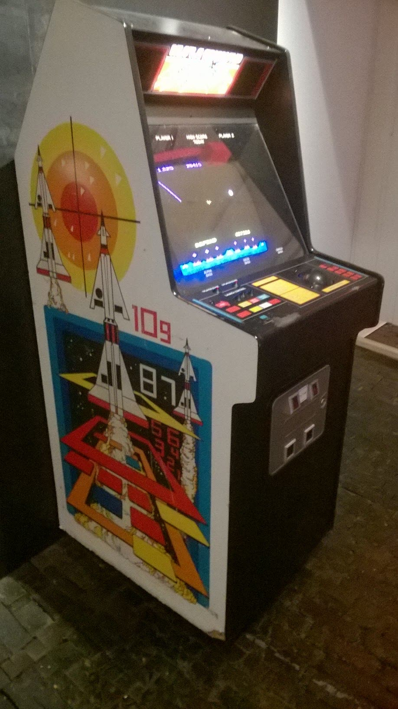
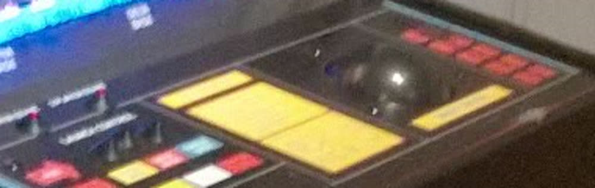
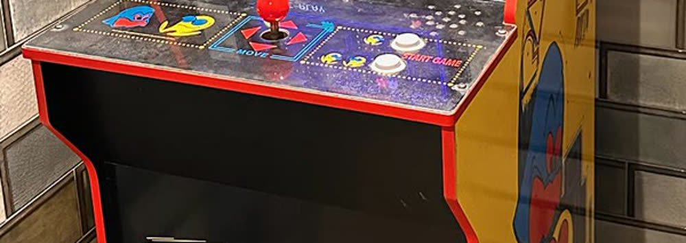
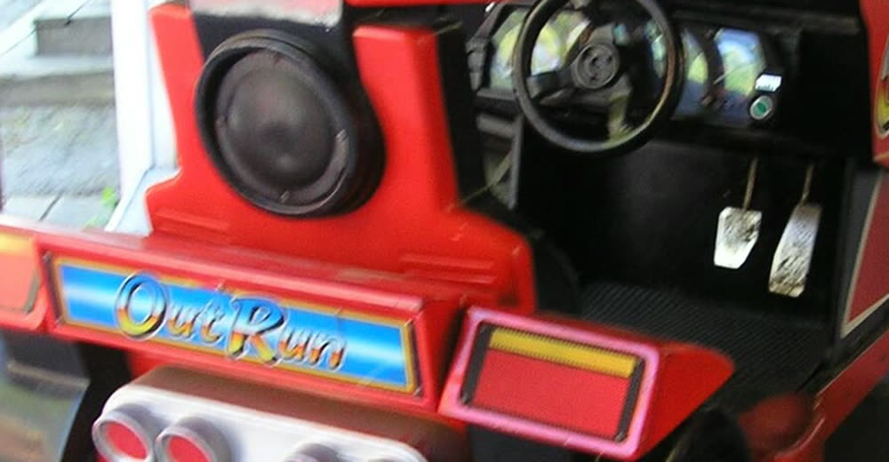

The control panel is the one part of an arcade cabinet a player's hands actually touched, and
it is the fastest way to tell two machines apart at a glance. This page is the drawing
reference for the 56×80 cabinet art on the select screen: **which device each machine used,
how many buttons, and where they sat** — grounded in cited text AND, where a photograph could
be found, in the photograph. It is the panel twin of
[[console-hardware-silhouettes]], which covers the machines that were never coin-ops.

## In this game

**Every cabinet used to get the same panel: one joystick and two buttons.** Trevor caught it
(2026-09-13): *"we should also look when we should introduce more than a joystick and two
buttons... as eventually games got more complex with more buttons, more levers, etc."*

That generic panel was not merely vague, it was **false on the most-played cabinet in the
game**: [[breakout]] is Level 1, and Breakout has no joystick at all. Its own page already
said so — *"rotary knob (paddle controller), horizontal movement only"* — and the art
contradicted it. `.claude/rules/theme-authoring.md` §"DRAW A REAL THING" and §"Mechanics
fidelity, wiki-grounded" both already required this; nothing had applied them to the panel.

`js/ui/cabinet-art.js` now carries a per-cabinet `controls` descriptor, and **its absence
means "not yet sourced", never "assume a joystick"** — a machine this page does not document
is an arcade-historian follow-up, not a licence to improvise.

**And the standard rose mid-pass.** Trevor: *"make sure we base them on actual discovered text
and imagery of an arcade cabinet."* Text alone was already wrong once — see Missile Command
below, where the photograph contradicted nothing but **added two facts no text source we hold
contains**. Entries are therefore marked **TEXT** or **TEXT + IMAGERY**, and the photographs
live in this vault (§Media) so the next author can check the drawing against the machine.

Related: [[console-hardware-silhouettes]] · [[breakout]] · [[pac-man]] · [[out-run]] · [[q-bert]] · [[street-fighter-ii]] · [[space-invaders]] · [[joust]] ·
[[galaga]] · [[dragons-lair]] · `.claude/rules/theme-authoring.md`

## The device vocabulary

What each input device is, and the one or two things that survive at 56×80:

| Device | What it is | Survives at cabinet scale as |
|---|---|---|
| **Rotary knob (paddle)** | A dial you spin; one axis only | A round cap with a **pointer mark** — without the mark it reads as a button |
| **Trackball** | A ball rolled with the palm | A **dome with a highlight** — a flat disc reads as a plate |
| **Steering wheel** | A wheel, often with shifter and pedals | A **ring with a hole** — spokes alone read as a plus sign (this was a real defect) |
| **2-way stick** | Left/right only | A ball-top stick on a small plate |
| **4-way stick** | No diagonals; a square gate | A ball-top stick on a **square gate plate** |
| **4-way rotated 45°** | Gate points at the corners | Corner marks instead of edge marks |
| **8-way stick** | Free movement | A ball-top stick, round gate |
| **Buttons** | 0–6 | Three across, wrapping to a second row |

## Per-cabinet, as drawn

| Lv | Cabinet | Controls | Sourcing |
|---|---|---|---|
| 1 | [[breakout]] | **Rotary knob, NO buttons, NO joystick** | TEXT |
| 2 | [[space-invaders]] | 2-way stick + 1 large pale fire button (2 red START buttons sit apart, upper right) | **TEXT + IMAGERY** |
| 3 | [[pac-man]] | **4-way stick, no gameplay buttons** | **TEXT + IMAGERY** |
| 4 | [[galaga]] | 2-way stick + 1 fire | TEXT |
| 5 | [[joust]] | 2-way stick + the one **Flap** button | TEXT |
| 6 | [[donkey-kong]] | *not sourced* — keeps the generic panel | **GAP** |
| 7 | [[dragons-lair]] | stick + 1 sword button | TEXT |
| 12 | [[street-fighter-ii]] | 8-way + **SIX** buttons (3 punch, 3 kick) | TEXT |
| 21 | [[out-run]] | **Wheel + shifter + pedals** | **TEXT + IMAGERY** |
| 22 | [[q-bert]] | 4-way **rotated 45°**, no buttons | TEXT |
| 23 | Missile Command *(no wiki page yet — see ref 3)* | **Trackball RIGHT, three wide YELLOW buttons LEFT** | **TEXT + IMAGERY** |

Levels 8–20 and 24–25 are home computers, consoles and non-games. They keep the generic panel
and **that is itself a known wrong**: the select screen draws them as upright arcade cabinets
when the honest object is a console or a computer. That is the same observation that produced
the COMPUTER ROOM act (`docs/ROADMAP.md` §2), and it is tracked there, not here.

## What the photographs changed

**Missile Command is the case for this rule.** The text source says *"trackball + three fire
buttons"*, and the first drawing put a small trackball on the left with three accent-coloured
squares on the right. The photograph shows **the trackball on the RIGHT**, and the three fire
buttons as **large yellow rectangles on the LEFT**. Neither fact appears in any text source
this wiki holds, and both are wrong in a way a reader would notice.

**Out Run's deluxe cabinet is a sit-down car**, not an upright with a panel: the photograph
shows a real wheel, a dashboard, and **two floor pedals**. The game's shell is an upright, so
the wheel and shifter stay on the panel and the pedals are drawn on the base — an honest
compromise, recorded rather than hidden. (Out Run did also ship in upright form.)

**Pac-Man confirmed a distinction worth keeping:** the photograph's only buttons are
**1 PLAYER / START GAME**. Start buttons are not gameplay buttons, and the descriptor counts
gameplay buttons — so `buttons: 0` is right, and a reader comparing art to photo should know
why.

## Rejected as a sourcing basis: replica cabinets

Trevor suggested Numskull's officially-licensed cabinet range as a photo source, and flagged
the licence question himself. Both halves of the answer are worth keeping:

- **Licensing:** commercial product photography is all-rights-reserved. Such images may be
  **looked at** to check a drawing; they are never stored in this vault (research/WIKI.md
  §Media).
- **And more importantly, a replica cannot establish the original's layout.** The licensed
  **quarter-size Space Invaders** cabinet was consulted for this pass. Its panel shows a white
  ball-top joystick and **three** buttons. The original Taito upright takes a **2-way joystick
  and one fire button** (plus start buttons). The product copy claims *"everything from the
  artwork, shape and buttons match the original"* — **marketing copy is not a citation**, and
  a quarter-scale cabinet with a USB controller is built to modern parts.

**⚠️ CORRECTION, same day.** Trevor then pointed at a restoration blog documenting a real,
unrestored **Taito Space Invaders upright** — and the original's panel turns out to be
**stick + one large pale fire button + two red START buttons set apart at the upper right**.
That is *consistent* with the replica, not contradicted by it. **My worked example was wrong:**
I had counted the replica's three buttons against a text source that mentions only the fire
button, forgetting the distinction I had just written down two paragraphs earlier for Pac-Man —
**start buttons are not gameplay buttons.**

The rule survives intact, but for the right reason, and it is worth stating precisely:
**a replica is not distrusted because it is usually wrong — it is distrusted because you cannot
tell from the replica whether it is right.** Here it happened to be faithful. The only way to
know that was to find the original. Space Invaders is therefore now **TEXT + IMAGERY**, sourced
to the restoration photographs and not to the merchandise.

### Looked at, not stored — `numskull-space-invaders-quarter-size`
- **Source:** [Official Space Invaders Quarter Size Arcade Cabinet — Numskull](https://numskull.com/products/official-space-invaders-quarter-size-arcade-cabinet)
- **Shows:** a white ball-top joystick, a white centre button, and two red buttons on a printed
  blue panel with orange trim
- **Rights:** commercial product photography — reference link only, not stored
- **Weight:** replica, therefore a SECONDARY source; cannot establish the original's layout —
  though in this instance it proved faithful (see the correction above)
- **Retrieved:** 2026-09-13

### Looked at, not stored — `arcadeblogger-taito-space-invaders-restoration`
- **Source:** [Taito Space Invaders Restoration 1 — Arcade Blogger (Tony Temple)](https://arcadeblogger.com/2026/02/23/taito-space-invaders-restoration-1/)
- **Shows:** an unrestored original Taito upright, panel clearly readable: the **bare joystick
  shaft** left of centre (the blog notes the ball top is missing — *"I'm missing a joystick
  top"*), one **large pale fire button**, a small button at the far left, and **two red START
  buttons at the upper right**. Also documents cigarette burns on the panel and an early
  serial number.
- **Rights:** blog photography, all rights reserved — reference link only, not stored
- **Serial number 000871** — *"This looks to be a very early build of this iconic cabinet.
  Number 000871 — a cool bonus!"* An early-production unit that then sat in a dry rural
  outbuilding for over twenty years, which is about the best provenance a panel layout can
  have: almost nothing has had the chance to be replaced with a modern part.
- **Weight:** **PRIMARY for the original cabinet** — a real machine, photographed before
  restoration, so nothing has been "improved" toward what a modern eye expects. This is the
  best class of source this page has found, and the kind to look for first.
- **⚠️ Open question this source raised, and it is a good one.** A commenter on the post asks:
  *"Did all of the Taito cabs in the UK have the L-R joystick? We (mostly) had buttons here."*
  If correct, **some Taito Space Invaders cabinets shipped with left/right BUTTONS instead of
  a joystick** — a regional or revision variant. This is a reader comment, not a citation, so
  it is recorded as an open question at low weight, **not** acted on. It is also the cleanest
  possible illustration of this page's own discipline: even a primary photograph of a real
  machine establishes *that* machine, and "the original" may not be one thing.
- **Retrieved:** 2026-09-13 Recorded because a replica photo looks
exactly as authoritative as a museum photo and is not, and this project has already shipped
one confident-but-wrong cabinet claim (the Mario Kart "no cabinet exists" error,
`.claude/rules/theme-authoring.md`).

## Golden Tee's swipe trackball — named by Trevor, sourced, not yet drawn

Trevor, 2026-09-13: *"Like how the golf simulator cabinets had a white cue ball you use your
hand to swipe."* That is **Golden Tee Golf** (Incredible Technologies), and Wikipedia confirms
the mechanism: *"Instead of a regular joystick and buttons for controls, they used a
trackball, which Incredible Technologies had previously used for Capcom Bowling."* Its
signature feature is the trackball, and the swing is a hand swipe through it rather than a
press.

**`[unverified]`: the ball's colour.** No source read here describes it as white, so the "cue
ball" detail is Trevor's recollection and is recorded as such, not as a fact. If Golden Tee is
ever given a cabinet, find a photograph first — the whole point of this page.

It matters beyond one machine: it is the clearest example of a cabinet whose **input device IS
the game's identity**, which is the argument for drawing panels faithfully at all.

## Known exposure

**Only the control panels have been checked against photographs.** Every one of the 25 cabinet
SCREENS in `js/ui/cabinet-art.js`, and the machine silhouettes on
[[console-hardware-silhouettes]], were authored from text descriptions by the same hand under
the same habits that produced all three errors above (journal **F29**). There is no evidence
they are wrong and none that they are right. Recorded here so the next pass knows exactly what
has and has not been verified, rather than inheriting an unearned confidence.

## Media

Reference photographs, stored in the vault so the drawings above stay auditable
(research/WIKI.md §Media). All are freely licensed.

### `missile-command-cabinet.jpg`

- **Shows:** the whole cabinet. **Caveat:** this machine has been modified — there is an extra
  control cluster at the lower left that is not original — so only the trackball and the three
  large yellow fire buttons should be read as canonical.
- **Source:** [File:Missile Command.jpg — Wikimedia Commons](https://commons.wikimedia.org/wiki/File:Missile_Command.jpg)
- **Author:** Hotdamnslap (2015-11-27)
- **Licence:** CC BY-SA 4.0
- **Retrieved:** 2026-09-13

### `missile-command-control-panel.jpg`

- **Shows:** the detail that corrected the drawing — trackball RIGHT, three wide yellow
  buttons LEFT. A crop of the image above.
- **Source:** crop of [File:Missile Command.jpg](https://commons.wikimedia.org/wiki/File:Missile_Command.jpg)
- **Author:** Hotdamnslap (2015-11-27)
- **Licence:** CC BY-SA 4.0
- **Retrieved:** 2026-09-13

### `pac-man-control-panel.jpg`

- **Shows:** the red ball-top 4-way stick with its printed MOVE diamond, and that the only
  buttons present are 1 PLAYER / START GAME.
- **Source:** crop of [File:Pac-Man arcade machine, De Notaris Schaijk.jpg — Wikimedia Commons](https://commons.wikimedia.org/wiki/File:Pac-Man_arcade_machine,_De_Notaris_Schaijk.jpg)
- **Author:** YosemiteYamper (2026-05-25)
- **Licence:** CC BY-SA 4.0
- **Retrieved:** 2026-09-13

### `out-run-sit-down-cockpit.jpg`

- **Shows:** the deluxe cabinet is a sit-down car — wheel, dashboard, and two floor pedals.
- **Source:** crop of [File:Outrun-sit-down-cabinet.jpg — Wikimedia Commons](https://commons.wikimedia.org/wiki/File:Outrun-sit-down-cabinet.jpg)
- **Author:** Liftarn (2006-05-24)
- **Licence:** CC BY-SA 3.0
- **Retrieved:** 2026-09-13

## References

1. [[breakout]] — in-wiki: "rotary knob (paddle controller), horizontal movement only." The source of the Level 1 correction.
2. [[pac-man]] — in-wiki: "four-way joystick (no diagonals)."
3. [Missile Command controls](https://www.arcade-museum.com/Videogame/missile-command) — Museum of the Game: Atari 1980, Dave Theurer, "trackball + three fire buttons." Corroborated by [Missile Command — Wikipedia](https://en.wikipedia.org/wiki/Missile_Command), which adds that Theurer chose the trackball for speed over a joystick. **[fetched, via research/arcade-cabinets-by-era.md]**
4. [[street-fighter-ii]] — in-wiki: "8-way joystick + six buttons (three punch, three kick — light/medium/heavy). The six-button layout became the fighting-game standard."
5. [[out-run]] — in-wiki: "steering wheel + stick shift (high/low gear) + accelerator/brake pedals; deluxe sit-down cabinet."
6. [[q-bert]] — in-wiki: "four-way joystick rotated 45 degrees to match Q*bert's diagonal movement axes."
7. [Golden Tee Golf — Wikipedia (raw wikitext)](https://en.wikipedia.org/w/index.php?title=Golden_Tee_Golf&action=raw) — "Instead of a regular joystick and buttons for controls, they used a trackball, which Incredible Technologies had previously used for Capcom Bowling"; the trackball as the series' signature feature. **[fetched]**
8. Wikimedia Commons photographs of real cabinets, stored in this vault under `wiki/media/arcade-control-panels/` with their licences — the imagery half of every **TEXT + IMAGERY** row above. **[images viewed]**
9. [Official Space Invaders Quarter Size Arcade Cabinet — Numskull](https://numskull.com/products/official-space-invaders-quarter-size-arcade-cabinet) — consulted and **rejected as a sourcing basis** (see §Rejected above): a licensed quarter-scale replica whose panel carries three buttons where the original takes one. Its product copy ("everything from the artwork, shape and buttons match the original") is marketing, not a citation. Image looked at, deliberately **not** stored — commercial photography. **[fetched, look-only]**
10. [Taito Space Invaders Restoration 1 — Arcade Blogger](https://arcadeblogger.com/2026/02/23/taito-space-invaders-restoration-1/) — restoration documentation of an original unrestored Taito upright; the source of the Level 2 panel layout and of the correction above. Photographs looked at, deliberately **not** stored (all rights reserved). **[fetched, look-only]**
