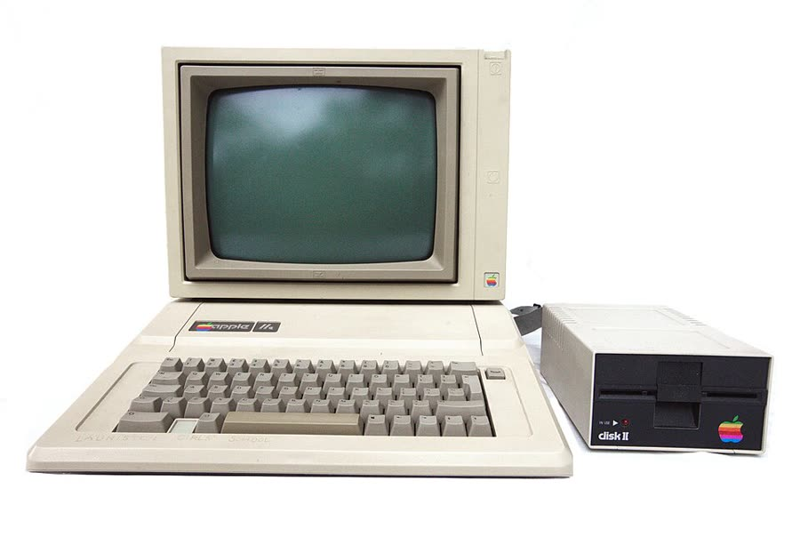
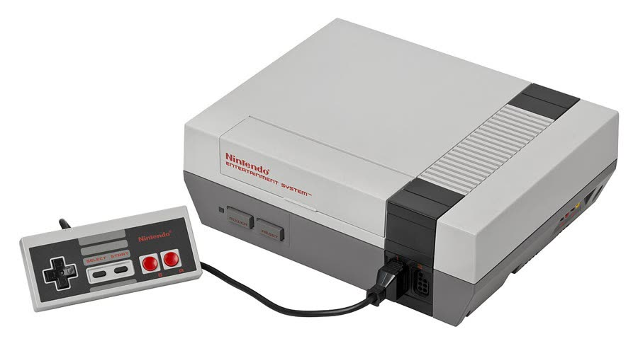
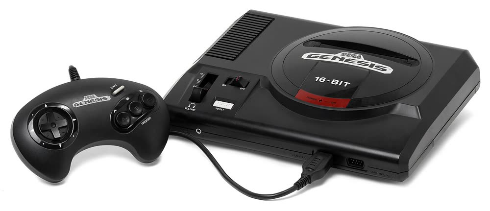
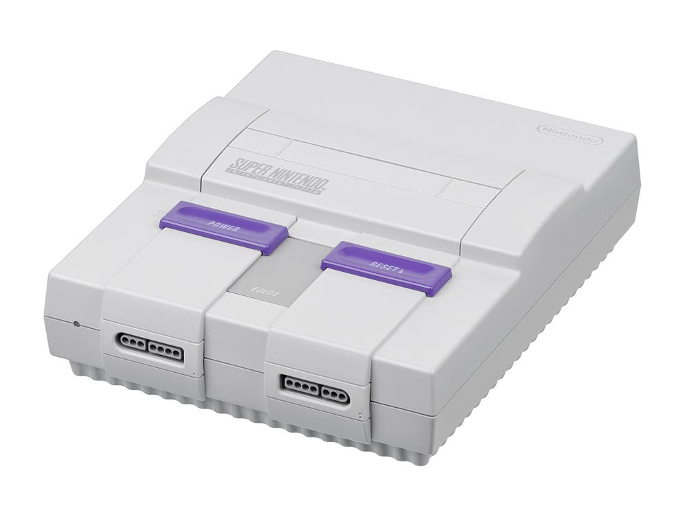
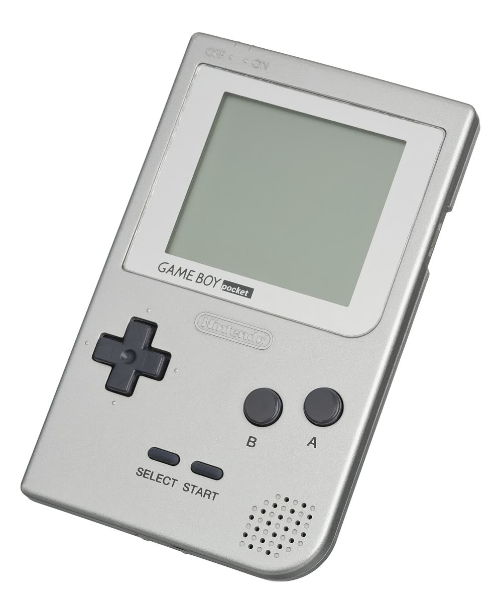
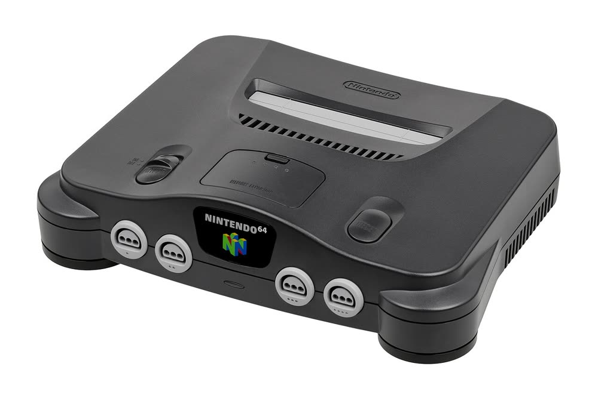
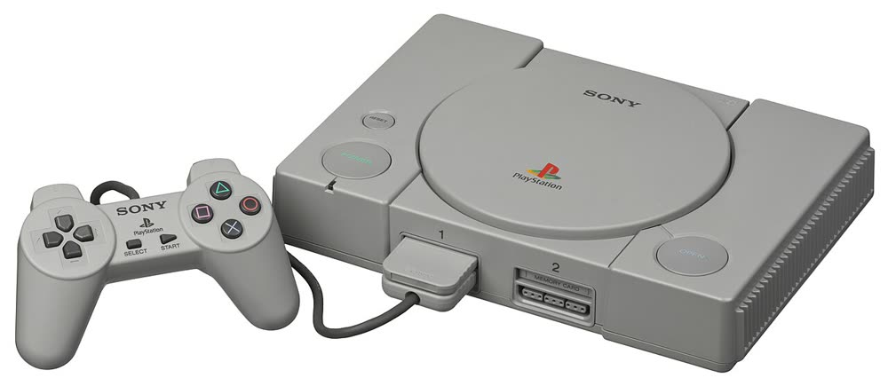
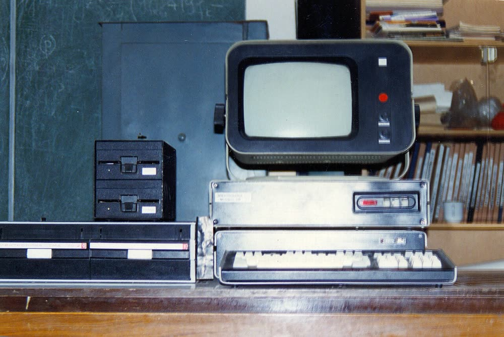
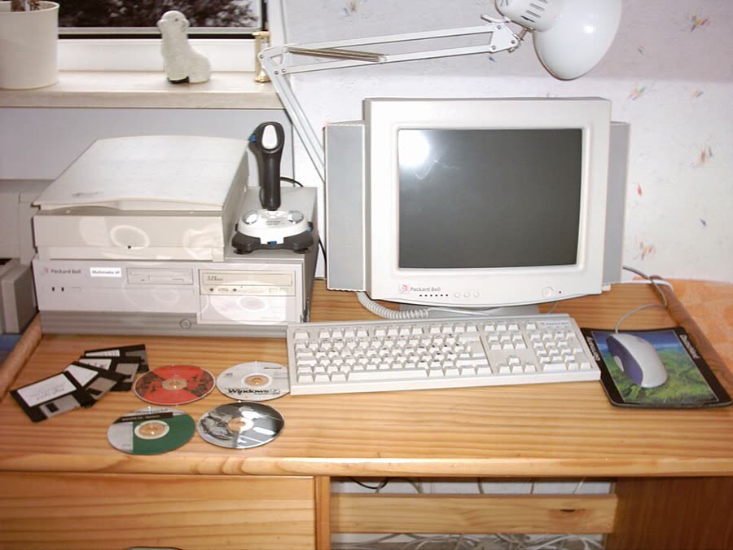

When a Keystroke Kingdom station is a **console or PC game**, the honest object to draw is **the
machine it actually ran on** — and the game has been doing this since Act 2 shipped. This page is
the drawing reference: for each machine, the **silhouette** and the **two or three unmistakable
details** that survive at cabinet-art scale (roughly 56×80 pixels on the select screen), plus the
era/bit-depth each should be rendered at. It is deliberately not a spec sheet — at that size,
colour and outline are the whole message.

## In this game

The principle lives on [[home-games-in-cabinets]]: **draw a real thing** — a real cabinet where
one exists, the real console where one does not. This page supplies the "real console" half.

**The vocabulary already exists in the design bible.** `.claude/rules/levels/act2.md` sets the
Computer Wing as *"A long room behind the Mystery Cabinet. **Computers and consoles from
different eras line the walls, each one running a classic game.**"* — and the act files name the
specific object per level: *"The NES in the center of the room"* (L9 Super Mario Bros),
*"A gold-cartridge NES beside a wooden TV"* (L10 Zelda), *"A computer running the original"*
(L8 Tetris), *"A computer running the first great CD-ROM game"* (L13 Myst), *"A Game Boy Pocket
on a backlit stand"* (L15 Pokémon). Act 7 can simply use the same grammar.

**The Hardware wing (added 2026-09-14)** extends that same grammar past the arcade and the
console shelf into the PC itself: a proposed bonus wing tracing the home computer from the living
room (Commodore 64 plugged straight into the family TV) through the CD-ROM/sound-card "multimedia
PC" and the two-machine LAN link, to the dial-up 56k tower and finally the 2003–04 broadband/LCD
desk. See "The Hardware wing — five more stations" below for the five new stations; each follows
the same drawing-reference format as the console entries above.

Related: [[home-games-in-cabinets]] · [[nintendo-vs-system]] · [[nes-hardware]] ·
[[mario-kart]] · [[gran-turismo]] · [[excitebike]] · [[need-for-speed-underground]] · [[f1-25]] ·
[[sixteen-bit-era]] · [[early-3d-era]] · [[commodore-64]] · [[56k-modem]] · [[dialup-modem]] ·
`.claude/rules/theme-authoring.md`

## Which machine to draw: the one it DEBUTED on

*(Trevor, 2026-09-13: "Of course many of these were later created into arcade games, but most
(Mario) were home first and later ported to an arcade cabinet after finding popularity and
arcade nostalgia.")*

He is right, and it is the rule that decides every station in Acts 2–4:

> **Draw the platform the game shipped on FIRST. A later arcade conversion does not change
> what the game was.**

The worked case is the one he named. *Super Mario Bros.* shipped for the Famicom/NES on
**13 September 1985**; **VS. Super Mario Bros.** — Nintendo's own arcade version, running NES
hardware inside a cabinet — followed in **February 1986** ([[nintendo-vs-system]]). So an
arcade Super Mario Bros. genuinely exists, and Level 9 is still an **NES**, because that is
where the game was born and where a child met it.

This also keeps two existing rules from fighting each other. [[home-games-in-cabinets]] says a
licensed arcade conversion is real and may be drawn — that page exists because a "no cabinet
exists" claim was once shipped wrongly. This page says which one to draw *here*. Both hold:
**the conversion is real; the debut platform is what this game depicts.**

Two consequences worth stating, because they are not symmetrical:

- **Arcade-first titles stay cabinets even when they had famous home ports.** Donkey Kong
  (1981), Dragon's Lair (1983), Street Fighter II (1991), Out Run, Q*bert and Missile Command
  are coin-ops that later reached living rooms. They are drawn as cabinets.
- **Home-first titles stay machines even when they later reached an arcade.** Super Mario Bros.,
  Zelda, Sonic, Donkey Kong Country, Pokémon, Myst.

And where a title is genuinely ambiguous or the debut is contested, **say so on its page rather
than picking** — the ordering is a factual claim like any other and needs its citation.

## The facts — machine by machine

### Nintendo Entertainment System (North America, 1985/86) — draw at 8-bit

- **Two-tone grey with a black stripe and red lettering.** The signature is the **front-loading,
  zero-insertion-force cartridge slot, modelled on a videocassette recorder**, behind a small
  hinged door. Nintendo chose the VCR look deliberately so the machine read as consumer
  electronics rather than a toy — which is itself a lovely fact for this project.
- **Detachable controllers** plug into two seven-pin ports on the front (unlike the Famicom).
- Dates: North America **18 October 1985** (test market), **27 September 1986** nationwide.
- **The Japanese Famicom is a different drawing:** *"predominantly white plastic with a dark red
  trim,"* **top-loading**, with **hardwired controllers stored in moulded pockets** on the case.
  Do not mix the two.
- **Silhouette at 56×80:** a low, wide grey slab; the black stripe as one dark horizontal band;
  the cartridge door as a lighter rectangle in the lower front; one red pixel-run for the
  lettering. Palette guidance: [[nes-hardware]].

### Super Nintendo Entertainment System (North America, 1991) — draw at 16-bit

- **The North American model is boxy**, with **purple sliding switches** and a **dark grey eject
  lever**; the loading bay has a curved top surface deliberately shaped to discourage stacking
  things on it. Designed by **Lance Barr**.
- **The controller is the fastest identifier:** the diamond layout with **lavender concave X/Y**
  and **purple convex A/B** — an arrangement that became the basis for many later controllers.
- **The Japanese Super Famicom and the PAL SNES share a different, rounder design** with darker
  grey accents and buttons. If the scene is meant to be a North American living room, draw the
  boxy purple-switched one.
- Dates: Japan **21 November 1990**, North America **23 August 1991**.
- **Silhouette at 56×80:** a pale grey box, slightly taller-fronted than the NES, with **two
  purple dots** (the sliding switches) as the read-at-a-glance detail and a dark eject lever
  between them. The cartridge sits proud on top.

### Sony PlayStation (1994/95) — draw at PS1-era fidelity

- **A grey case** — the retail original (SCPH-1000/1001 family) was grey through the late 1990s.
  **Do not draw it black**; black is the later PS2, and a "black original PlayStation" is exactly
  the plausible-looking error this project keeps catching. *(A summary of the main Wikipedia
  article produced "black exterior" during this very pass; the `PlayStation models` article was
  fetched specifically to correct it.)*
- **Top-opening CD lid** with **front-mounted power and open buttons** — the lid is the
  silhouette. Original dimensions roughly **45 × 260 × 185 mm**.
- **The controller's four face buttons are geometric symbols** — green triangle, red circle,
  blue cross, pink square — per designer Teiyu Goto. At small scale, four coloured dots in a
  diamond is instantly legible as "PlayStation."
- Dates: Japan **3 December 1994**, North America **9 September 1995**, Europe **29 September
  1995**.
- The **PS one** redesign (**7 July 2000**) is smaller (≈38 × 193 × 144 mm) and **white** — a
  different object; only draw it if the scene is post-2000.

### PlayStation 2 (2000) — draw at sixth-generation fidelity

- **Matte black slab**, horizontal by default, standable vertically on an optional stand; a
  **tray-loading disc drive** and **two USB ports** on the front. Sony shipped many colour
  variants (ceramic white, aqua, metallic silver, navy blue), but matte black is the default
  reading.
- Dates: Japan **4 March 2000**, North America **26 October 2000**, Europe **24 November 2000**.
  The **Slimline** redesign arrived **November 2004** (NA 25 November 2004): much smaller,
  **top-loading**, with a built-in Ethernet port.
- **Silhouette at 56×80:** a black rectangle standing on end, with **one thin blue-lit slot** and
  a pair of tiny USB squares. The blue light is the whole identity.

### Sega Genesis, Model 1 (North America, 1989) — draw at 16-bit

The machine [[sonic-the-hedgehog]] shipped on. **Photograph-verified 2026-09-13.**

- **Black, low and wedge-shaped**, with a **ridged vent strip** running along the top-left.
- **The identifier is the circular raised cartridge bay** at the right of the top surface,
  carrying a **red `GENESIS` badge and `16-BIT`**. Nothing else in this era looks like it.
- **Silhouette at 56×80:** a black slab; one lighter ridged band top-left; a **dark circle**
  right of centre with a **red pixel-run** across it. The red-on-black badge is the whole
  message at this size.
- **⚠️ Not the Japanese Mega Drive and not the Model 2.** The JP Mk1 and the 1993 Model 2 are
  different objects; Sonic in a North American living room is the Model 1.

### Super Nintendo (North America, 1991) — the photograph, added

Text notes are above; the photograph confirms and sharpens them.

- **Light grey, boxy**, with a darker grey recessed panel across the top.
- **The identifier is the pair of PURPLE sliding switches** on the front face — power and
  reset, side by side, unmistakable at any size.
- Two controller ports on the angled lower front.
- **Silhouette at 56×80:** a pale grey box, a darker inset band on top, and **two purple pixel
  blocks** low on the front.

### Game Boy Pocket (1996) — draw at 4-shade dot-matrix

`.claude/rules/levels/act3.md` names this exact model for L15: *"A Game Boy Pocket on a backlit
stand."* **Photograph-verified 2026-09-13.**

- **Silver-grey, portrait**, notably slimmer than the original 1989 Game Boy.
- **A grey-green LCD** high on the face inside a slightly lighter bezel.
- **Black cross D-pad lower-left**; **two round grey buttons lower-right**, labelled B then A
  (B is to the LEFT of A); two small slanted SELECT/START pills between them, below.
- **Speaker holes** in the lower-right corner.
- **Silhouette at 56×80:** a tall pale rectangle; a grey-green screen block in its upper half;
  a black cross and two dots below. The portrait orientation alone distinguishes it from every
  other machine on this page.

### Nintendo 64 (1996) — draw at early-3D fidelity

- **Dark charcoal, curved and organic** — the only console here that is not a rectangle.
- **Cartridge slot on the top surface.**
- **The identifier is four controller ports in a CURVED ROW across the front**, and the
  `NINTENDO 64` logo with its multicoloured 3D "64" in the centre front.
- **Silhouette at 56×80:** a dark rounded mass with **four pale notches along its front edge**
  and a small colour fleck at centre. Four ports is the fact — every other console here has
  two.

### Sony PlayStation (SCPH-1000/1001, 1994/95) — the photograph, added

- **GREY.** Photograph-confirmed, which matters because this wiki records a summariser
  asserting mid-research that the original PlayStation was black. **Black is the PS2.**
- A flat wide box with a **round CD lid** occupying most of the top surface.
- Controller: grey, D-pad left, the **four-symbol face buttons** right.
- **Silhouette at 56×80:** a pale grey slab with a **circle** on top. The circle is the message.
- **⚠️ Model note:** the photograph is an **SCPH-1000 (Japanese launch)**. The North American
  SCPH-1001 is the same industrial design and the same grey; where a claim depends on port or
  badge detail rather than shape and colour, source the NA unit.

### Elektronika 60 (USSR, early 1980s) — draw as a terminal, not a PC

The machine [[tetris]] was created on, and the honest object for Level 8 —
`.claude/rules/levels/act2.md` says *"a computer running the original."* A **Russian clone of
the PDP-11**, at the Dorodnitsyn Computing Center. **Photograph-verified 2026-09-13.**

- **Nothing here is beige.** The palette is **charcoal and pale bone-grey**, with a small red
  lamp — unmistakably not a western desktop, which is the whole point of drawing it.
- **A small, deep CRT in a charcoal bezel**, notably boxy, with a **red indicator on its right
  cheek**.
- It sits on a **pale grey chassis** carrying a dark control strip with small pale buttons.
- **A separate pale keyboard slab** below, and **stacked drive bays** to one side.
- **Silhouette at 56×80:** three pale-grey horizontal slabs (chassis, keyboard) under a dark
  boxy tube, with one red pixel. The charcoal-and-bone palette does the identifying.
- **What is ON the screen matters as much as the machine:** the original had **no graphical
  interface**, so Tetris was drawn with **spaces and brackets** — typed characters on a
  monochrome phosphor. Draw text, never coloured tetrominoes. (The coloured-block look belongs
  to the IBM PC port and everything after it.)

### Apple II / Apple IIe (1977–1986, beige) — draw at 8-bit

The machine [[stickybear]] actually ran on, and therefore the honest object for any
Stickybear set dressing. **There is no Stickybear arcade cabinet and there never was**
([[bear-on-a-blue-screen]]) — this is the thing to draw instead.

- **The computer IS the keyboard.** A low beige wedge with the keys sunk into its top
  surface; there is no separate keyboard and no separate box. Everything else sits on it.
- **The monitor sits ON TOP of the wedge** — a deep-bezelled beige CRT, roughly as wide as
  the machine under it.
- **The Disk II drive stands alongside**, and it is the fastest identifier in the whole
  silhouette: a small beige box with a **BLACK front face**, a horizontal slot with a
  fold-down door, a small red IN USE lamp, and the rainbow Apple logo on the face.
- **The rainbow Apple stripes** (green, yellow, orange, red, purple, blue, top to bottom)
  on a recessed badge at the wedge's front-left, with `//e` beside it.
- **Colour: beige, not grey.** Wikipedia records the 1984 case revision as *"dyed plastic
  mold in a slightly darker beige"* with *"more-professional-looking print on darker
  keycaps (small black lettering, versus large white print)"*. **The light-grey machine is
  the 1987 "Platinum" IIe** — a different, later object. Stickybear's 1982–88 run belongs
  to the beige one.
- **Silhouette at 56×80:** beige wedge across the lower third with three short rows of
  darker keycaps; monitor as a beige rectangle above it with a dark inset screen; a narrow
  beige box to the right with a black lower half. Three details survive at that size — the
  **rainbow stripe run**, the **black drive face**, and the **screen colour**.
- **What is on the screen matters:** for Stickybear it is **blue**, which is the line's
  Apple II house palette ([[bear-on-a-blue-screen]]) — not the green phosphor of the mono
  monitor in the photograph below.

### A period beige PC (late 1980s – mid 1990s) — draw at VGA fidelity

The honest object for an MS-DOS game — [[gizmos-and-gadgets]] (1993) is the case this was
sourced for. **This section replaces an earlier `[unverified]` note** that recorded no
description at all and warned against inventing one.

- **A horizontal desktop case with the CRT sitting ON TOP of it**, and the keyboard on the
  desk in front. This is the defining arrangement — a tower beside the desk is a different,
  later look.
- **Everything is the same beige**: case, monitor, keyboard.
- **The front face carries the drives**, grouped to one side: a **wide 5.25-inch slot** and
  a **smaller 3.5-inch slot**, with a small power lamp beside them. Vents or a badge fill
  the rest of the face.
- **Silhouette at 56×80:** three stacked beige blocks — monitor, case, keyboard — with two
  dark horizontal slots of *different widths* on the case's front. The differing slot
  widths are what say "floppy era" rather than "any beige box".
- **Honest limit:** the photograph below is a mid-1990s Packard Bell, not a specifically
  1993 machine, and it carries CD-ROM and Windows 95 markers that a 1993 DOS scene should
  not. What it verifies is the **form** — horizontal case, monitor on top, keyboard in
  front, drives on the front face — not the model.

### A modern sim rig — **[unverified] / under-documented**

The sim terminus wants a **wheel-and-pedal rig**, and no description of one was sourced. (The
period-PC half of this gap was **closed 2026-09-13** — see the section above.) **Do not invent
hardware detail from feel** — the same failure mode that produced the "no cabinet exists" error.

The one thing that *is* established: [[f1-25]] and modern sims are genuinely played on **wheel
and pedal rigs**, and force feedback is a documented consumer technology from the late 1990s
(`research/racing-games-by-era.md` §11). A wheel clamped to a desk in front of a monitor is a
real object and a safe thing to draw.

## The Hardware wing — five more stations (2026-09-14)

*Added for a proposed bonus wing (**THE HARDWARE**) tracing the home computer from the living
room through the LAN era to always-on broadband. **Tooling note, stated plainly rather than
silently worked around:** this research pass had no download/binary-write tool available — every
photograph below was found and its licence verified live via WebFetch, but the bytes could not be
committed to the vault this session. Every entry uses the schema's **"Looked at, not stored"**
form (WIKI.md §Media) rather than a false claim of storage. A follow-up pass with a fetch-capable
tool can download the exact files named below (all confirmed freely licensed) into
`wiki/media/console-hardware-silhouettes/` without repeating this research.*

### Commodore 64 + 1541 disk drive, on a family television (1982) — draw at 8-bit

The "living room" machine — no dedicated monitor required, no separate keyboard, no tower.
Everything lives in one low wedge, exactly like the Apple IIe above but a different silhouette
and a different route to the screen.

- **The case is a "breadbin"** — c64-wiki.com (a domain-canonical fan wiki, the reference of
  record for Commodore hardware the way DoomWiki is for id software games) describes the
  prototype case, shared with its predecessor the VIC-20, as *"a brown breadbox with black keys
  and brighter function keys."* Commodore's own case colour is more precisely a warm
  putty/tan-brown than a true "beige" — do not draw it Apple-IIe beige; draw it a shade browner
  and boxier, with darker, near-black keycaps and a lighter run of function keys (F1–F8, doubled
  via Shift) along the right edge.
- **It plugs directly into a television — no external box needed.** Wikipedia's main C64 article
  is explicit: *"The C64 had a built-in RF modulator and thus could be plugged into any television
  set."* This is a real and useful contrast with the VIC-20 one generation earlier, whose own
  Wikipedia article says Commodore "did not include an RF modulator inside the computer's case
  because of FCC regulations" and shipped a separate external modulator box instead — so **draw a
  single coax lead running from the back of the C64 straight to the television's antenna
  terminals**, not a separate switch box sitting between them. (A composite/S-video option to a
  dedicated monitor like the Commodore 1702 existed too, but the TV-plug scene is the "living
  room" one this station wants.)
- **The 1541 disk drive sits beside it** — a separate beige box, "almost as deep as the computer
  is wide" (Wikipedia, `Commodore 64 hardware`-adjacent text), with a horizontal 5¼-inch floppy
  slot. Early 1982–83 units were off-white to match the VIC-20; **from 1983 the 1541 switched to
  the beige that matches the C64** — draw the matched-beige version for an "1982" living-room
  scene only if the scene is understood to be slightly later, or draw the earlier off-white unit
  for strict 1982 accuracy. It connects by a **grey ribbon-style serial cable with round DIN
  connectors**, daisy-chainable so more than one drive could share a single port on the computer.
  Early spring-eject drives earned the nickname "Toaster Drive" because stuck disks needed prying
  out with a knife — a fun, sourced, non-punishing detail if a caption is ever wanted.
- **Silhouette at 56×80:** a low brown-tan wedge with three short rows of dark keycaps and a
  lighter function-key column on the right; a single thin cable arcing from its back to a boxy CRT
  television (not a dedicated monitor — a real 1979–82-style wood-veneer or dark-plastic family
  TV, per [[console-hardware-silhouettes]]'s own Act 2 vocabulary); a beige box with a horizontal
  slot sitting to the wedge's right, joined by a short grey DIN cable.
- **Do not draw:** a beige-grey Apple-style case (that is the IIe, a different machine, above); an
  external RF switch box between computer and TV (the C64's modulator is internal); a modern
  "C64 Mini" or "TheC64" reissue (a later revision, evidence for itself only, per WIKI.md §Media).
  **Draw instead:** the brown breadbin plugged straight into a real family television by one coax
  lead, the 1541 alongside it on its own cable.

### A multimedia PC, 1995 — draw at VGA/early-CD-ROM fidelity

The distinguishing move from the "period beige PC" station already on this page is **the case
shape itself, not a new colour**: that section's defining arrangement was a *horizontal* desktop
case with the CRT sitting on top of it. By 1995 that arrangement was already dated.

- **It is a tower now, not a horizontal desktop box.** Wikipedia's `Tower case` article, citing a
  contemporary *PC Week* piece, states plainly: *"The transition in dominance from horizontal
  desktop computers to towers was mostly complete by 1994."* So the monitor no longer sits ON the
  case — **the tower stands on the floor or beside the desk, and the monitor sits on the desk by
  itself**, the single biggest silhouette change between this station and the 1993 one.
- **CD-ROM and a sound card become standard equipment right at this date.** Wikipedia's
  `Compaq Presario` article — the dominant home-PC brand of the moment, launched August 1993 —
  states: *"Later models produced after September 1995 came with a CD-ROM drive and sound card as
  standard equipment."* That is the exact hinge the 1995 station should dramatize: draw the
  tower's front face with **an exposed horizontal CD-ROM drive bay** (a tray slot, plus a
  floppy-drive slot below or beside it) in addition to the 3.5″ floppy the 1993 station already
  has — the sound card itself is internal and invisible, so the CD-ROM bay is what visually says
  "multimedia" now.
- **External speakers, mounted to the monitor rather than freestanding.** The same Compaq Presario
  article, describing the following year's 1X25 monitor line: *"All of these monitors came with
  JBL Pro speakers which could be mounted to the sides of the monitors."* A pair of small
  rectangular speaker boxes clipped to the monitor's outer edges is a more period-specific detail
  than two loose speakers sitting on the desk, and it is directly sourced.
- **Silhouette at 56×80:** a beige tower standing upright beside a beige monitor that now sits
  directly on the desk (not stacked); a horizontal slot near the top of the tower's front face for
  the CD-ROM tray, a narrower slot below it for the floppy; two small speaker boxes flanking the
  monitor. Same beige as the 1993 station — the differences are the tower silhouette, the second
  drive slot, and the monitor standing free.
- **Do not draw:** the CRT-on-top horizontal case (that is the 1993 station, and drawing it here
  erases the one distinguishing fact this station exists to show); a smoked-black "rocket ship"
  tower with beveled drive-bay covers (that is Compaq's *Series 2*, 1996–98 — one generation
  later, per the same Wikipedia article — a later revision, not this one). **Draw instead:** a
  plain beige tower, boxier and less styled, exactly matching the "transition just happened"
  moment Wikipedia dates to 1994–95.
- **Reference photograph (not stored, licence-verified):** [File:Compaq Presario 4110 1996.jpg
  — Wikimedia Commons](https://commons.wikimedia.org/wiki/File:Compaq_Presario_4110_1996.jpg),
  author "Glad nicke3," released into the public domain. One year later than 1995, so it verifies
  the tower *form factor* the same way the existing Packard Bell photo verifies the 1993 station's
  form and not its exact model — name the caveat if this image is ever used as the direct drawing
  reference.

### Two PCs joined by a cable (1995) — draw the connector, not a diagram

What a two-PC LAN link actually looked like on a desk or floor was a **coaxial cable strung
between two BNC T-connectors**, one plugged into the back of each machine's network card.

- **10BASE2 ("thinnet") was the small-network standard of the moment, and Wikipedia says so in
  exactly these terms:** *"10BASE2 uses thin coaxial cable terminated with BNC connectors... No
  hub is required as with 10BASE-T, so the hardware cost was minimal... ideal for a small network
  of two or three machines, perhaps in a home where easily concealed wiring was an advantage."*
  That is the two-PC scene precisely: no separate networking box on the desk at all, just the
  cable itself, each end capped with a **T-shaped BNC connector** and the two unused arms of the
  outermost T's closed off with a small cylindrical **50 Ω terminator cap**.
- **The card that makes this possible sits in the back of each tower** — a Realtek RTL8019-based
  ISA network card of the exact period, photographed on Commons, is captioned *"a transitional
  network card with both BNC 'Thinnet' (left) and Twisted pair (right) connectors"* — a single
  expansion-card bracket with two different round/socket connectors side by side, the BNC one
  round and metal, the twisted-pair one a small plastic modular jack. Only the BNC side is in use
  for a straight two-machine link.
- **The older, simpler alternative is a null-modem serial cable** — Wikipedia's `Null modem`
  article: *"Null modem cables were a popular method for transferring data between... early
  personal computers,"* and on the Amiga specifically "was a common way of playing multiplayer
  games between two machines." No card at all is needed for this option — just a cable running
  from one PC's rear DB9/DB25 serial port to the other's. This is the right choice to draw if the
  scene wants to feel more improvised/bedroom than networked/office; 10BASE2 is the right choice
  if it wants to feel like a genuine two-node LAN.
- **The cultural anchor for why two PCs got cabled together at all in 1993–95 is Doom.**
  Wikipedia's Doom (1993) article: *"Multiplayer was initially only playable over local
  networks,"* and *"within hours of Doom's release, university networks began banning Doom
  multiplayer games"* — corroborating (without itself supplying a photograph) that this exact
  cabled-together arrangement is what a whole generation associates with "playing a game
  together" on two separate machines, years before the word "LAN party" was common currency.
- **Silhouette/scene at 56×80:** two beige towers, each with a short black coax stub exiting a
  BNC T-piece on its rear expansion bracket; a single cable running along the floor or desk
  between them; a small grey cylinder capping each unused T-arm. Skip the diagrammatic "network
  cloud" imagery entirely — the honest object is a literal wire on the floor between two desks.
- **Do not draw:** a modern Ethernet switch/hub or router (10BASE2's whole point was that none was
  needed for two or three machines — drawing one contradicts the sourced fact); a wireless
  connection of any kind (this era predates consumer Wi-Fi — see the Act 4 accuracy guard already
  on this wiki, and note it applies here too). **Draw instead:** the bare coax-and-T-connector
  link, or the simpler serial null-modem cable if the scene wants to read as more improvised.
- **Reference photographs (not stored, licences verified):**
  [File:Network card.jpg — Wikimedia Commons](https://commons.wikimedia.org/wiki/File:Network_card.jpg)
  (CC BY-SA 3.0 / GFDL, author "Nixdorf") — the ISA card with its BNC-and-twisted-pair bracket;
  [File:BNC Tee connector, with Ethernet cable connected-92166.jpg — Wikimedia Commons](https://commons.wikimedia.org/wiki/File:BNC_Tee_connector,_with_Ethernet_cable_connected-92166.jpg)
  (CC BY-SA 4.0, author Raimond Spekking) — the T-connector itself, a modern photo of an
  unchanged standardized part, cited for the object's shape rather than as a period scene.

### A 56k-modem home tower, 1999 — draw at late-90s beige-tower fidelity

Builds on [[56k-modem]] and [[dialup-modem]] (which cover the V.90 standard and the handshake
sound) with the one thing neither covers: **what the box looked like.**

- **Two real options existed, and both are worth naming rather than picking one silently.** An
  **external modem** was a separate beige box on the desk with its own power brick and a row of
  **status LEDs on the front** — Wikimedia Commons' own file for a US Robotics 56K unit is
  captioned by its uploader as showing *"LED indicator lights and labeled controls on its front
  panel"* on a beige case. An **internal modem** was a plain expansion card inside the tower,
  invisible except for two small RJ11 phone jacks on the back bracket — Wikipedia's `Softmodem`
  article notes that *"In 1997, the AC'97 standard for computer audio would introduce channels for
  modem use, making software modem technology common in PCs,"* which is consistent with internal
  cards becoming the default in pre-built OEM towers by 1999 even though this source does not
  give an exact market-share number — **state that as "internal became the OEM default, external
  boxes remained a common separate purchase," not as a precisely-quantified split.**
- **The external box is the more recognisable object to draw**, precisely because its blinking
  lights were the visible half of the handshake sound [[dialup-modem]] already documents — a
  child (or a parent) watching the lights flicker in sequence while the modem screeches is the
  whole cultural memory in one frame.
- **Silhouette at 56×80 (external option):** a low beige rectangular box, wider than tall, with a
  horizontal row of small coloured LED dots along its front face and a short phone cord (not a
  network cable — this is a phone line, RJ11 not RJ45) trailing off one side toward the wall.
- **Silhouette detail (internal option):** the beige tower from the multimedia-PC station above,
  unchanged in silhouette, with one addition on the back bracket cluster: two small round RJ11
  jacks (labelled, where legible, LINE and PHONE) — nothing else about the tower changes.
- **Do not draw:** a modern USB modem dongle or a router with multiple antennas (both are 2000s+
  broadband objects, wrong era entirely — see the broadband station below for what that looks
  like); a modem with a visible coax cable (that is the broadband/cable-modem station, next).
  **Draw instead:** the beige LED box on a phone cord, or the same beige tower with two small
  RJ11 jacks added to its back panel.
- **Reference photograph (not stored, licence-verified):**
  [File:US Robotics 56K Modem Front.JPG — Wikimedia Commons](https://commons.wikimedia.org/wiki/File:US_Robotics_56K_Modem_Front.JPG)
  (dual GFDL/CC BY 3.0, author Xiaowei) — beige case, front LED row, exactly the object described
  above.

### A broadband tower with an LCD panel, 2004 — draw at flat-panel fidelity

The desk genuinely gets its space back here, and the fact is dated precisely enough to use as
this station's headline detail.

- **2003 is the sourced hinge year.** Wikipedia's `Computer monitor` article: *"In 2003, LCDs
  outsold CRTs for the first time, becoming the primary technology used for computer monitors."*
  A 2004 desk is therefore drawn the year AFTER the LCD crossover — this is the first of this
  page's stations where the flat panel is the *typical* choice rather than the exotic one.
- **The proportions are the whole visual story.** Wikipedia's `Cathode-ray_tube` article explains
  why the CRT it replaces was so deep: *"The depth of a CRT is related to its screen size"* — the
  electron gun has to physically fit inside the tube's neck, so a CRT of a given screen width is
  nearly as deep as it is wide. An LCD of the same era has no electron gun at all: draw it as a
  genuinely **thin flat rectangle** (a few inches deep including its stand) beside the squat,
  cube-like CRT box the 1993/1995 stations both draw — the contrast between the two silhouettes,
  side by side, is more informative than either drawn alone.
  **Do not invent an exact millimetre figure** for the 2004 panel's thinness (no period-specific
  depth measurement was sourced this pass) — draw the contrast qualitatively: CRT deep-and-boxy,
  LCD thin-and-flat.
- **The tower itself does not need to change from the 1999 station** — a beige (by 2004,
  increasingly light-grey or off-white) tower is still period-correct; the LCD panel and the
  broadband box are what date the scene, not the case.
- **Broadband replaced the phone-line modem with an always-on box with its own LEDs, on a coax or
  phone-DSL line rather than a standard phone jack.** A period cable-modem photograph on Commons
  (uploaded 2007, one Serbian Thomson unit) is described by its uploader as *"a rectangular
  beige/cream-coloured housing with status LED indicators visible on the front panel"* — visually
  a close cousin of the external 56k box above, but fed by a thicker coaxial cable rather than a
  thin phone cord, and always lit rather than dialling.
- **Silhouette at 56×80:** a light beige/grey tower; beside it, a genuinely thin flat rectangle on
  a small stand (the LCD) rather than a deep cube (the CRT it replaced); a small beige box with
  LEDs and a thick coax lead sitting near the tower, no phone cord in sight.
- **Do not draw:** a widescreen ultra-thin monitor (that is a 2010s+ revision, per the LCD-vs-CRT
  crossover source above being specifically about the *2003* transition, not a later one); a
  wireless router with visible antennas (broadband in 2004 was still commonly a wired Ethernet
  drop to one PC before Wi-Fi routers were the default home object — treat a wireless antenna
  detail as **[unverified]** for this exact date rather than drawing it). **Draw instead:** the
  boxy beige/cream wired broadband modem with its LED row and thick coax lead.
- **Reference photographs (not stored, licences verified):**
  [File:Acer AL1715.jpg — Wikimedia Commons](https://commons.wikimedia.org/wiki/File:Acer_AL1715.jpg)
  (CC BY-SA 3.0 / GFDL, author Sheep221) — a beige-bezelled flat LCD panel; the photograph itself
  is dated 2007 and this pass could not confirm the AL1715 model's exact release year, so treat it
  as **form-factor evidence only** (thick plastic bezel, rectangular flat panel), not as a
  2004-dated object;
  [File:Thomson cable modem 20070224.jpg — Wikimedia Commons](https://commons.wikimedia.org/wiki/File:Thomson_cable_modem_20070224.jpg)
  (dual GFDL/CC BY-SA 3.0, author Maduixa) — same caveat: photographed 2007, three years after
  this station's date, verifying the general beige-box-with-LEDs form rather than a specific 2004
  model.

## Media

Reference photographs, stored in the vault so the drawing claims above stay auditable
(research/WIKI.md §Media). Both are freely licensed and safe to redistribute.

### `apple-iie-system.jpg`

- **Shows:** the whole arrangement in one frame — wedge, monitor-on-top, Disk II with its
  black face, slot and rainbow logo, and the recessed `apple //e` badge. This image is the
  direct source of the silhouette notes above.
- **Source:** [File:Iie-system.jpg — Wikimedia Commons](https://commons.wikimedia.org/wiki/File:Iie-system.jpg)
- **Author:** Pratyeka (own work, 2016-12-18)
- **Licence:** CC BY-SA 4.0
- **Retrieved:** 2026-09-13

### `nes-console-and-controller.jpg`

- **Shows:** the details that survive at 56×80 and that the Level 9 station is drawn from —
  two-tone grey, the flat cartridge door, the dark right stripe, the red wordmark run, and the
  controller's black cross plus two red buttons. Drawn from this frame, not from the text
  notes above, per journal F29.
- **Source:** [File:NES-Console-Set.jpg — Wikimedia Commons](https://commons.wikimedia.org/wiki/File:NES-Console-Set.jpg)
- **Author:** Evan-Amos
- **Licence:** Public domain
- **Retrieved:** 2026-09-13

### `sega-genesis-model-1.jpg`

- **Shows:** the circular cartridge bay and the red GENESIS / 16-BIT badge — the two details
  that survive at cabinet scale.
- **Source:** [File:Sega-Genesis-Mod1-Set.jpg — Wikimedia Commons](https://commons.wikimedia.org/wiki/File:Sega-Genesis-Mod1-Set.jpg)
- **Author:** Evan-Amos
- **Licence:** Public domain
- **Retrieved:** 2026-09-13

### `super-nintendo-na.jpg`

- **Shows:** the two purple sliding switches, which are the fastest identifier at any size.
- **Source:** [File:Nintendo-Super-NES-Console-FL.jpg — Wikimedia Commons](https://commons.wikimedia.org/wiki/File:Nintendo-Super-NES-Console-FL.jpg)
- **Author:** Evan-Amos
- **Licence:** Public domain
- **Retrieved:** 2026-09-13

### `game-boy-pocket.jpg`

- **Shows:** the exact model `act3.md` names for Level 15, and its portrait proportions.
- **Source:** [File:Game-Boy-Pocket-FL.jpg — Wikimedia Commons](https://commons.wikimedia.org/wiki/File:Game-Boy-Pocket-FL.jpg)
- **Author:** Evan-Amos
- **Licence:** Public domain
- **Retrieved:** 2026-09-13

### `nintendo-64.jpg`

- **Shows:** the four front ports in their curved row — the count that distinguishes it from
  every two-port console on this page.
- **Source:** [File:Nintendo-64-Console-FL.jpg — Wikimedia Commons](https://commons.wikimedia.org/wiki/File:Nintendo-64-Console-FL.jpg)
- **Author:** Evan-Amos
- **Licence:** Public domain
- **Retrieved:** 2026-09-13

### `sony-playstation-scph-1000.jpg`

- **Shows:** that it is **grey**, and the round CD lid. Stored partly as standing evidence
  against the black-PlayStation error this wiki already had to correct once.
- **Source:** [File:PlayStation-SCPH-1000-with-Controller.jpg — Wikimedia Commons](https://commons.wikimedia.org/wiki/File:PlayStation-SCPH-1000-with-Controller.jpg)
- **Author:** Evan-Amos
- **Licence:** Public domain
- **Retrieved:** 2026-09-13

### `elektronika-60.jpg`

- **Shows:** the charcoal-and-bone palette, the boxy tube with its red lamp, the chassis
  control strip, the pale keyboard and the drive bays — everything the Level 8 station is
  drawn from.
- **Source:** [File:ArmSCII 02, First Armenian Computer - Electronika 60.jpg — Wikimedia Commons](https://commons.wikimedia.org/wiki/File:ArmSCII_02,_First_Armenian_Computer_-_Electronika_60.jpg)
- **Author:** Vahram Mekhitarian
- **Licence:** CC BY-SA 3.0
- **Retrieved:** 2026-09-13

### `beige-desktop-pc-monitor-on-top.jpg`

- **Shows:** the form this section describes — horizontal case, monitor on top, keyboard in
  front, drives on the front face. **Caveat, repeated from above:** it is a mid-1990s
  Packard Bell with CD-ROM and Windows 95 on the desk, so it verifies the arrangement, not
  a 1993 model.
- **Source:** [File:Old packard bell pc.jpg — Wikimedia Commons](https://commons.wikimedia.org/wiki/File:Old_packard_bell_pc.jpg)
- **Author:** Spacekid (own work, 2003-07-21)
- **Licence:** CC0 (public domain dedication)
- **Retrieved:** 2026-09-13

## Bit-depth mapping (for Trevor's "8-bit / 16-bit / 24-bit renderings")

| Machine | Era to render at | Kit tier it sits beside |
|---|---|---|
| NES / Famicom | 8-bit, ~52-colour NES palette ([[nes-hardware]]) | `8bit` |
| SNES / Super Famicom | 16-bit, warm SNES palette ([[sixteen-bit-era]]) | `mode7` |
| PlayStation | early 3D, dithered low-colour ([[early-3d-era]]) | `ps1` |
| PlayStation 2 / period PC | sixth-gen; "24-bit" reads as true-colour — lighting and glow do the work | `modern` |
| Wheel rig / modern PC | present day | `modern` |

*Note on "24-bit": it is a **colour-depth** term (8 bits per RGB channel = 16.7 million colours),
not a console generation, and no 1990s console was marketed as 24-bit. Used as Trevor used it —
"the era where the picture stops being palette-limited" — it maps cleanly to the PS2/PC step
above. Worth saying plainly so nobody writes "the 24-bit era" on a history card.* **[unverified]
as a historical term of art — treat it as an authoring shorthand, not a fact.**

## References

1. [Nintendo Entertainment System — Wikipedia](https://en.wikipedia.org/wiki/Nintendo_Entertainment_System) — the NES's "two-tone gray color scheme with a black stripe and red lettering"; the "front-loading, zero insertion force slot modeled after a videocassette recorder"; two seven-pin controller ports; the deliberate consumer-electronics (not toy) positioning; the Famicom's "predominantly white plastic with a dark red trim," top-loading slot and hardwired controllers in moulded pockets; Famicom 15 July 1983, NES 18 October 1985 test market / 27 September 1986 nationwide. **[fetched]**
2. [Super Nintendo Entertainment System — Wikipedia](https://en.wikipedia.org/wiki/Super_Nintendo_Entertainment_System) — the boxy North American model with purple sliding switches and dark grey eject lever, designed by Lance Barr, and its curved loading-bay surface; the lavender concave X/Y and purple convex A/B buttons; the rounder, darker-accented Super Famicom/PAL design; the regional cartridge-shape difference; Japan 21 November 1990, NA 23 August 1991, UK/Ireland/France 11 April 1992. **[fetched]**
3. [PlayStation models — Wikipedia](https://en.wikipedia.org/wiki/PlayStation_models) — **the source that settles the colour**: the original SCPH-1000/1001 models had a **grey case**, with a top-loading CD mechanism and front power/open buttons, dimensions ≈45 × 260 × 185 mm; the PS one (2000) is smaller (≈38 × 193 × 144 mm) and white. **[fetched]**
4. [PlayStation (console) — Wikipedia](https://en.wikipedia.org/wiki/PlayStation_(console)) — the controller's four geometric face buttons (green triangle, red circle, blue cross, pink square) and Teiyu Goto's explanation of them; the PS one redesign date of 7 July 2000; release dates Japan 3 December 1994, NA 9 September 1995, Europe 29 September 1995, Australia 15 November 1995. Note: a summary of this page produced an **incorrect** "black exterior" for the original console — the colour claim on this wiki page rests on reference 3, not this one. **[fetched]**
5. [PlayStation 2 — Wikipedia](https://en.wikipedia.org/wiki/PlayStation_2) — matte black default finish with many colour variants; horizontal slab with optional vertical stand; tray-loading drive; two USB ports; Japan 4 March 2000, NA 26 October 2000, Europe 24 November 2000; the Slimline redesign of November 2004 (NA 25 November 2004) with top-loading drive and built-in Ethernet. **[fetched]**
6. Internal design sources (not web): `.claude/rules/levels/act2.md` (the Computer Wing's "computers and consoles from different eras line the walls" framing, and the per-level machine descriptions at L8–L10), `.claude/rules/levels/act3.md` (L13 Myst's computer, L15's "Game Boy Pocket on a backlit stand"), `.claude/rules/theme-authoring.md` (faithful-not-gimmicky, era fidelity). **[read in-repo]**

## Corrections from this pass (2026-09-13)

1. **"The original PlayStation was black."** False, and it was generated live during this pass by
   a summariser reading the main PlayStation article. The retail original is **grey**; black is
   the PS2. Logged here because it is a textbook adjacent-fact bleed, of exactly the
   Myst/Riven class this project's calibration list already warns about.
2. **"24-bit" is not a console generation.** It is a colour depth. Fine as authoring shorthand;
   never as a historical claim.

## Unsourceable / weakly-sourced items

- **Period PC towers, monitors and modern sim rigs** — the 1995/1999/2004 tower and monitor gap is
  now closed above (2026-09-14 pass); **the modern sim rig remains open.**
- **Nintendo 64, GameCube, Xbox and Game Boy hardware appearance** — not researched here. The
  Game Boy Pocket already appears in `.claude/rules/levels/act3.md` as design intent, but this
  wiki carries **no sourced physical description** of it.
- **No image bytes were stored this pass (2026-09-14)** — the session had no download-capable
  tool. Every Hardware-wing photograph above is cited with a live-verified URL and licence but
  sits as a "Looked at, not stored" entry rather than a committed file in
  `wiki/media/console-hardware-silhouettes/`. A follow-up pass with a fetch tool can download the
  eight named files (all confirmed freely licensed: 2× Evan-Amos public domain, 2× GFDL/CC BY-SA
  public-domain-adjacent, 4× CC BY-SA 3.0/4.0) without repeating the research.
- **Internal-vs-external 56k modem prevalence in homes by 1999** — supported directionally (AC'97,
  1997, made softmodems "common in PCs" per Wikipedia) but **no market-share number was found**.
  Stated in the text above as a qualitative claim only, deliberately not quantified.
- **The Acer AL1715 LCD monitor's exact release year** and **the Thomson cable modem's exact
  model year** — both reference photographs are dated 2007 by upload metadata; neither page gave
  an original product-release year. Both are cited as **form-factor evidence only** for the 2004
  station, with the gap stated explicitly in each entry above — not smoothed over.
- **Whether a 2004 home broadband connection commonly had a wireless router with visible antennas**
  — not sourced either way this pass. Treated as **[unverified]** and excluded from the "draw
  this" guidance rather than assumed.
7. [Apple IIe — Wikipedia (raw wikitext)](https://en.wikipedia.org/w/index.php?title=Apple_IIe&action=raw) — the 1984 case revision as "dyed plastic mold in a slightly darker beige" with "darker keycaps (small black lettering, versus large white print)"; the January 1987 "Platinum IIe" colour change to light grey; the recessed metal ID badges showing the Apple logo with "//e". **[fetched]**
8. [File:Iie-system.jpg — Wikimedia Commons](https://commons.wikimedia.org/wiki/File:Iie-system.jpg) and [File:Old packard bell pc.jpg](https://commons.wikimedia.org/wiki/File:Old_packard_bell_pc.jpg) — the two reference photographs, stored in this vault under `wiki/media/console-hardware-silhouettes/` with their licences. Every silhouette detail above was read off these frames. **[images viewed]**
9. [File:NES-Console-Set.jpg — Wikimedia Commons](https://commons.wikimedia.org/wiki/File:NES-Console-Set.jpg) — Evan-Amos's public-domain hardware photography; the reference for the Level 9 console station. **[image viewed]**
10. [File:Sega-Genesis-Mod1-Set.jpg — Wikimedia Commons](https://commons.wikimedia.org/wiki/File:Sega-Genesis-Mod1-Set.jpg) — Evan-Amos, public domain. North American Genesis Model 1. **[image viewed]**
11. [File:Nintendo-Super-NES-Console-FL.jpg — Wikimedia Commons](https://commons.wikimedia.org/wiki/File:Nintendo-Super-NES-Console-FL.jpg) — Evan-Amos, public domain. NA Super Nintendo; the purple switches. **[image viewed]**
12. [File:Game-Boy-Pocket-FL.jpg — Wikimedia Commons](https://commons.wikimedia.org/wiki/File:Game-Boy-Pocket-FL.jpg) — Evan-Amos, public domain. The Game Boy Pocket named in act3.md. **[image viewed]**
13. [File:Nintendo-64-Console-FL.jpg — Wikimedia Commons](https://commons.wikimedia.org/wiki/File:Nintendo-64-Console-FL.jpg) — Evan-Amos, public domain. Four front controller ports. **[image viewed]**
14. [File:PlayStation-SCPH-1000-with-Controller.jpg — Wikimedia Commons](https://commons.wikimedia.org/wiki/File:PlayStation-SCPH-1000-with-Controller.jpg) — Evan-Amos, public domain. Confirms the original PlayStation is grey. **[image viewed]**
15. [File:ArmSCII 02, First Armenian Computer - Electronika 60.jpg — Wikimedia Commons](https://commons.wikimedia.org/wiki/File:ArmSCII_02,_First_Armenian_Computer_-_Electronika_60.jpg) — Vahram Mekhitarian, CC BY-SA 3.0. The reference for the Level 8 station. **[image viewed]**

## References — The Hardware wing (2026-09-14 pass)

*Five new stations, researched with no WebSearch budget available this session (used entirely by
a prior task in the same session) — every citation below is a direct WebFetch of a live page,
verified to resolve and to actually support the claim it's attached to, per the arcade-historian
"no URLs from memory" rule. No image bytes could be committed this pass (no download-capable tool
was available); every photograph is cited as "Looked at, not stored" per WIKI.md §Media, with its
licence confirmed live on its own Commons file page.*

16. [Commodore 64 — Wikipedia](https://en.wikipedia.org/wiki/Commodore_64) — "The C64 had a built-in RF modulator and thus could be plugged into any television set"; composite and S-Video output options for a dedicated monitor (e.g. the Commodore 1702). **[fetched]**
17. [Commodore VIC-20 — Wikipedia](https://en.wikipedia.org/wiki/Commodore_VIC-20) — contrast case: "Commodore did not include an RF modulator inside the computer's case because of FCC regulations. It can either be attached to a dedicated monitor or a TV set using the external modulator included with the computer" — the C64's built-in modulator (ref 16) is the generational change from this. **[fetched]**
18. [Commodore 1541 — Wikipedia](https://en.wikipedia.org/wiki/Commodore_1541) — 1982–83 off-white case matching the VIC-20, switching to beige matching the C64 "in 1983"; DIN-connector serial daisy-chain; the "Toaster Drive" spring-eject nickname; drive depth "almost as deep as the computer is wide." **[fetched]**
19. [Commodore 64 — c64-wiki.com](https://www.c64-wiki.com/wiki/Commodore_64) — domain-canonical Commodore fan wiki (DoomWiki-class reference of record for this hardware): "a brown breadbox with black keys and brighter function keys"; the built-in "TV-connector (HF-Modulator-Output)" — corroborates ref 16's built-in-modulator claim from an independent source. **[fetched]**
20. [File:Commodore-64-Computer-FL.jpg — Wikimedia Commons](https://commons.wikimedia.org/wiki/File:Commodore-64-Computer-FL.jpg) — Evan-Amos, public domain (photographed 2011/2017). Looked at, not stored this pass. **[described via Commons metadata, not pixel-viewed]**
21. [File:Commodore-64-1541-Floppy-Drive-01.jpg — Wikimedia Commons](https://commons.wikimedia.org/wiki/File:Commodore-64-1541-Floppy-Drive-01.jpg) — Evan-Amos, public domain (photographed 2018). Looked at, not stored this pass. **[described via Commons metadata, not pixel-viewed]**
22. [Tower case — Wikipedia](https://en.wikipedia.org/wiki/Tower_case) — citing a period *PC Week* article: "The transition in dominance from horizontal desktop computers to towers was mostly complete by 1994" — the sourced hinge fact distinguishing the 1995 multimedia-PC station from the existing 1993 horizontal-case station. **[fetched]**
23. [Compaq Presario — Wikipedia](https://en.wikipedia.org/wiki/Compaq_Presario) — "Later models produced after September 1995 came with a CD-ROM drive and sound card as standard equipment"; 1996 1X25-series monitors shipped with "JBL Pro speakers which could be mounted to the sides of the monitors"; the Presario line launched August 1993; the Series 2 (1996–98) "rocket ship" smoked-black-bezel towers are a later, distinct design — flagged as such, not drawn for 1995. **[fetched]**
24. [File:Compaq Presario 4110 1996.jpg — Wikimedia Commons](https://commons.wikimedia.org/wiki/File:Compaq_Presario_4110_1996.jpg) — public domain (author "Glad nicke3"). One year later than the 1995 target date; verifies tower form only. Looked at, not stored this pass. **[described via Commons metadata, not pixel-viewed]**
25. [10BASE2 — Wikipedia](https://en.wikipedia.org/wiki/10BASE2) — thin coaxial cable terminated with BNC T-connectors, 50 Ω terminator caps, "no hub is required," "ideal for a small network of two or three machines, perhaps in a home where easily concealed wiring was an advantage" — the direct source for the two-PCs-joined-by-a-cable station. **[fetched]**
26. [Null modem — Wikipedia](https://en.wikipedia.org/wiki/Null_modem) — "Null modem cables were a popular method for transferring data between the early personal computers from the 1980s to the early 1990s"; on the Amiga, "a common way of playing multiplayer games between two machines" — the simpler, card-free alternative connection method. **[fetched]**
27. [Doom (1993 video game) — Wikipedia](https://en.wikipedia.org/wiki/Doom_(1993_video_game)) — "Multiplayer was initially only playable over local networks"; "within hours of Doom's release, university networks began banning Doom multiplayer games" — cultural corroboration that two-PC cabled play was a real, dated (1993) practice, not an invented scene. **[fetched]**
28. [Network interface controller — Wikipedia](https://en.wikipedia.org/wiki/Network_interface_controller) — describes "A 1990s Ethernet network interface card that connects to the motherboard via the now-obsolete ISA bus... features both a BNC connector (left) for use in (now obsolete) 10BASE2 networks" alongside an 8P8C twisted-pair connector — the combo-card silhouette drawn on the back of each tower. **[fetched]**
29. [File:Network card.jpg — Wikimedia Commons](https://commons.wikimedia.org/wiki/File:Network_card.jpg) — dual GFDL / CC BY-SA 3.0 (author "Nixdorf"): "a transitional network card with both BNC 'Thinnet' (left) and Twisted pair (right) connectors," Realtek RTL8019-based ISA card. Looked at, not stored this pass. **[described via Commons metadata, not pixel-viewed]**
30. [File:BNC Tee connector, with Ethernet cable connected-92166.jpg — Wikimedia Commons](https://commons.wikimedia.org/wiki/File:BNC_Tee_connector,_with_Ethernet_cable_connected-92166.jpg) — CC BY-SA 4.0 (author Raimond Spekking, 2018). A modern photo of an unchanged standardized part — cited for the T-connector's shape, not as a period scene. Looked at, not stored this pass. **[described via Commons metadata, not pixel-viewed]**
31. [Softmodem — Wikipedia](https://en.wikipedia.org/wiki/Softmodem) — "In 1997, the AC'97 standard for computer audio would introduce channels for modem use, making software modem technology common in PCs" — supports internal cards becoming the OEM-tower default by 1999, though no exact internal-vs-external market-share figure was found. **[fetched]**
32. [File:US Robotics 56K Modem Front.JPG — Wikimedia Commons](https://commons.wikimedia.org/wiki/File:US_Robotics_56K_Modem_Front.JPG) — dual GFDL / CC BY 3.0 (author Xiaowei, 2008): "beige-colored modem unit featuring LED indicator lights and labeled controls on its front panel." Looked at, not stored this pass. **[described via Commons metadata, not pixel-viewed]**
33. [Computer monitor — Wikipedia](https://en.wikipedia.org/wiki/Computer_monitor) — "In 2003, LCDs outsold CRTs for the first time, becoming the primary technology used for computer monitors" — the sourced hinge year for the 2004 broadband station's flat-panel monitor. **[fetched]**
34. [Cathode-ray tube — Wikipedia](https://en.wikipedia.org/wiki/Cathode-ray_tube) — "The depth of a CRT is related to its screen size," standard 90° deflection for computer monitors — the sourced reason a CRT reads as a deep box next to a thin LCD. **[fetched]**
35. [File:Acer AL1715.jpg — Wikimedia Commons](https://commons.wikimedia.org/wiki/File:Acer_AL1715.jpg) — dual CC BY-SA 3.0 / GFDL (author Sheep221, photographed 2007): beige-bezelled flat LCD panel. Model's exact release year not confirmed this pass — cited for form factor only. Looked at, not stored this pass. **[described via Commons metadata, not pixel-viewed]**
36. [File:Thomson cable modem 20070224.jpg — Wikimedia Commons](https://commons.wikimedia.org/wiki/File:Thomson_cable_modem_20070224.jpg) — dual GFDL / CC BY-SA 3.0 (author Maduixa, photographed 2007): "rectangular beige/cream-coloured housing with status LED indicators visible on the front panel." Three years later than the 2004 target date — cited for form factor only. Looked at, not stored this pass. **[described via Commons metadata, not pixel-viewed]**
